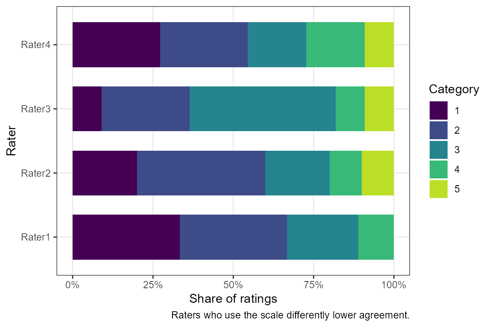
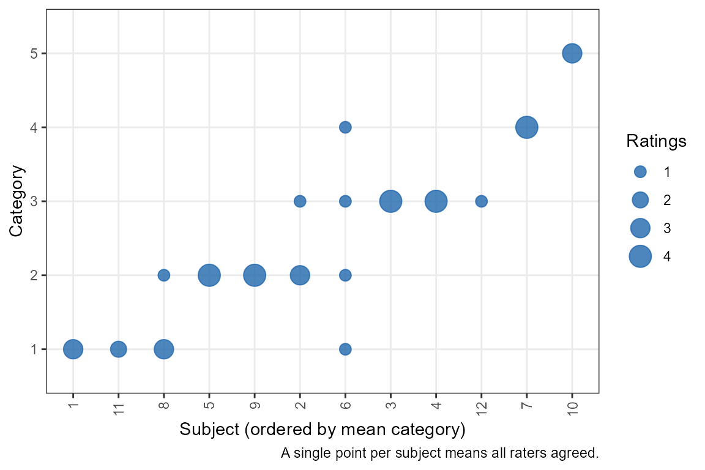
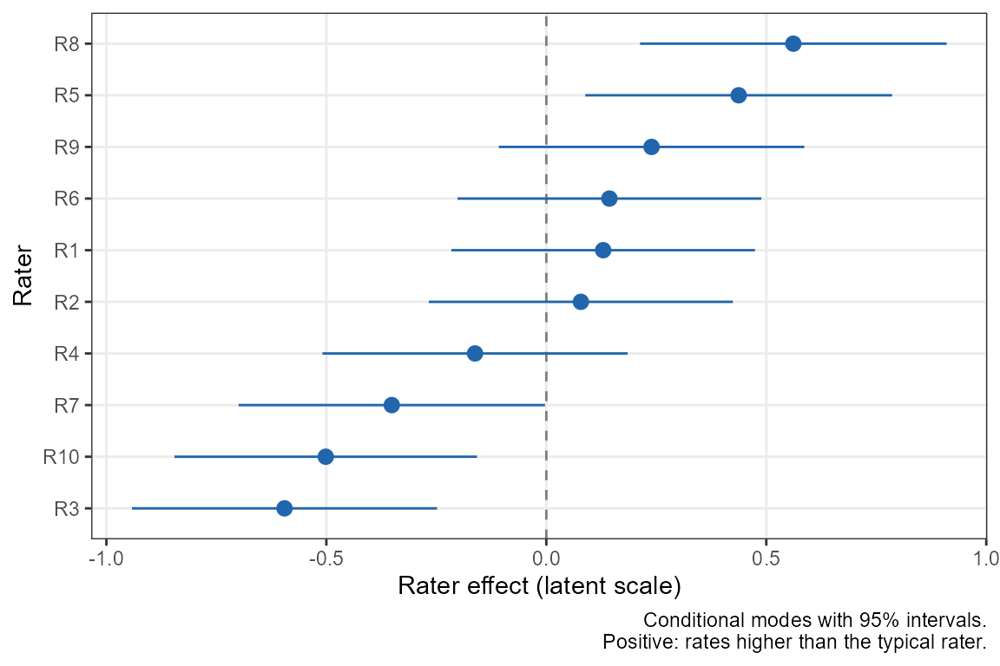
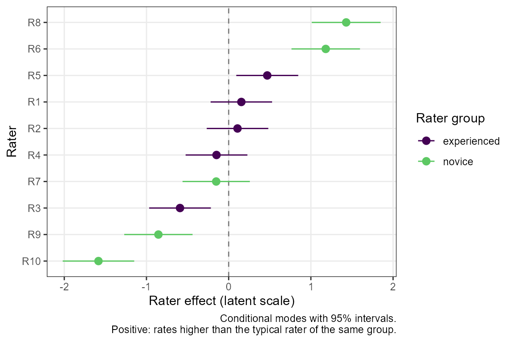

# Agreement for Categorical and Ordinal Ratings

## Background

Many measurements are not numbers on a continuous scale but
classifications. For example, a diagnosis (present or absent), a grade
(1 to 5), or a severity rating (none, mild, moderate, severe). When
several raters classify the same subjects, the question is how often
they agree. For continuous measurements, see instead the reliability
analysis vignette (ICCs) and the agreement analysis vignette (limits of
agreement).

`SimplyAgree` has two functions for categorical ratings. Both return a
standard `htest` object, with
[`summary()`](https://rdrr.io/r/base/summary.html) and
[`plot()`](https://rdrr.io/r/graphics/plot.default.html) methods.

| Function | Estimates | Use when |
|----|----|----|
| [`cac_test()`](https://aaroncaldwell.us/SimplyAgree/reference/cac_test.md) | Percent agreement, Gwet’s AC1/AC2, Fleiss’ kappa or Krippendorff’s alpha | Nominal or ordinal ratings, any number of raters |
| [`ord_kappa_test()`](https://aaroncaldwell.us/SimplyAgree/reference/ord_kappa_test.md) | The model-based kappa of Nelson and Edwards ([2015](#ref-nelson2015)) | Ordinal ratings from many raters sampled from a population; comparing groups of raters or subjects |

The older
[`agree_coef()`](https://aaroncaldwell.us/SimplyAgree/reference/agree_coef.md),
which reports four coefficients in one table, is superseded by
[`cac_test()`](https://aaroncaldwell.us/SimplyAgree/reference/cac_test.md)
(see [Legacy function](#legacy-function)).

Both functions accept data in the same three ways as
[`icc_test()`](https://aaroncaldwell.us/SimplyAgree/reference/icc_test.md):
a formula, `rating ~ rater | id`; long data, with `measure`, `item` (the
rater) and `id` column names; or wide data, one row per subject, with
each rater’s column in `col.names`. Ratings may be numeric, character or
factor, and missing ratings are allowed.

## Chance-corrected agreement coefficients

### An example

Take the example of Gwet ([2014](#ref-gwet)): 12 subjects rated by 4
raters on a 5-point scale, with some ratings missing.

``` r

ratings <- data.frame(
  Rater1 = c(1, 2, 3, 3, 2, 1, 4, 1, 2, NA, NA, NA),
  Rater2 = c(1, 2, 3, 3, 2, 2, 4, 1, 2, 5, NA, NA),
  Rater3 = c(NA, 3, 3, 3, 2, 3, 4, 2, 2, 5, 1, 3),
  Rater4 = c(1, 2, 3, 3, 2, 4, 4, 1, 2, 5, 1, NA))
raters <- c("Rater1", "Rater2", "Rater3", "Rater4")
```

The simplest summary is the percent agreement: the proportion of pairs
of ratings of the same subject that agree.

``` r

cac_test(col.names = raters, data = ratings, coef = "pa")
#> 
#>  Percent agreement for 4 raters
#> 
#> data:  Rater1, Rater2, Rater3, Rater4
#> 
#> alternative hypothesis: two.sided
#> 95 percent confidence interval:
#>  0.5417184 1.0000000
#> sample estimates:
#> percent agreement 
#>         0.8181818
```

Some of that agreement would happen by chance even if the raters
guessed. The chance-corrected coefficients all take the form \\
\frac{p_a - p_e}{1 - p_e}, \\ where \\p_a\\ is the observed agreement
and \\p_e\\ the agreement expected by chance: 1 means perfect agreement
and 0 means no more agreement than chance. The default coefficient is
Gwet’s AC1 ([Gwet 2008](#ref-gwet2008)).

``` r

cac_test(col.names = raters, data = ratings)
#> 
#>  Gwet's AC1 for 4 raters
#> 
#> data:  Rater1, Rater2, Rater3, Rater4
#> 
#> alternative hypothesis: two.sided
#> 95 percent confidence interval:
#>  0.4608133 1.0000000
#> sample estimates:
#> Gwet's AC1 
#>  0.7754441
```

The results of
[`cac_test()`](https://aaroncaldwell.us/SimplyAgree/reference/cac_test.md)
match those of the irrCAC package ([Gwet 2019](#ref-irrCAC)).

### Choosing a coefficient

The coefficients differ in how they define chance agreement:

- **Fleiss’ kappa** ([Fleiss 1971](#ref-fleiss1971)) and
  **Krippendorff’s alpha** ([Krippendorff 1970](#ref-krippendorff1970))
  use the overall proportion of ratings in each category: chance
  agreement is the probability that two ratings drawn at random fall in
  the same category. Krippendorff’s alpha also includes a small-sample
  correction for the number of pairs of ratings.
- **Gwet’s AC1** ([Gwet 2008](#ref-gwet2008)) uses the probability that
  a rater classifies a subject at random, which is small when raters
  mostly agree.

The difference matters when one category dominates. Here two readers
classify 50 scans, nearly all of them normal, and disagree on only two.

``` r

screen <- data.frame(
  reader1 = c(rep("normal", 45), "abnormal", "normal", "normal",
              "abnormal", "normal"),
  reader2 = c(rep("normal", 45), "normal", "abnormal", "normal",
              "abnormal", "normal"))
readers <- c("reader1", "reader2")

sapply(c("pa", "gwet", "fleiss", "krippendorff"), function(coef) {
  unname(cac_test(col.names = readers, data = screen,
                  coef = coef)$estimate)
})
#>           pa         gwet       fleiss krippendorff 
#>    0.9600000    0.9566724    0.4791667    0.4843750
```

The readers agree on 96% of scans, yet Fleiss’ kappa is only 0.48,
because with 94% of ratings normal, agreement by chance is already high.
This is the well-known “kappa paradox” ([Feinstein and Cicchetti
1990](#ref-feinstein1990)). Gwet’s AC1 stays close to the raw agreement.
Neither answer is wrong: kappa asks how well the readers agree *beyond
the agreement expected from the prevalence*, and with so few abnormal
scans there is little information about that. Report the percent
agreement alongside any chance-corrected coefficient, and the category
proportions when they are very unequal.

### Ordinal ratings and weights

With an ordered scale, a disagreement between 3 and 4 is less serious
than one between 1 and 4. `weights` gives partial credit to near misses.
The common choices are quadratic weights, which penalise a disagreement
by the square of its distance, and linear weights, which penalise it in
proportion to the distance ([Gwet 2014](#ref-gwet)). Weighted Gwet’s AC1
is called AC2.

``` r

sapply(c("unweighted", "linear", "quadratic"), function(w) {
  unname(cac_test(col.names = raters, data = ratings, weights = w)$estimate)
})
#> unweighted     linear  quadratic 
#>  0.7754441  0.8587391  0.9140007
```

Other schemes (`"ordinal"`, `"radical"`, `"ratio"`, `"circular"` and
`"bipolar"`) and custom weight matrices are also available. A custom
matrix has one row and column per category, values between 0 and 1, and
1 on the diagonal. For example, to give half credit to adjacent
categories only:

``` r

w <- diag(5)
w[abs(row(w) - col(w)) == 1] <- 0.5
cac_test(col.names = raters, data = ratings, weights = w)$estimate
#> Gwet's AC2 
#>  0.8271485
```

### The rating scale

Gwet’s AC1/AC2 and the weights depend on the full set of categories, not
just those that were used. By default the categories are the observed
ratings (or the levels of a factor). If the scale had a category no
rater used, list the full scale in `categories`:

``` r

# a 6-point scale on which no subject was rated 6
cac_test(col.names = raters, data = ratings, weights = "quadratic",
         categories = 1:6)$estimate
#> Gwet's AC2 
#>  0.9474078
cac_test(col.names = raters, data = ratings, weights = "quadratic")$estimate
#> Gwet's AC2 
#>  0.9140007
```

Character ratings are ordered alphabetically, which is rarely what an
ordinal scale needs. For ordinal labels, use a factor with the levels in
order (unused levels are kept as categories), or give `categories`.

``` r

severity <- c("none", "mild", "moderate", "severe", "extreme")
ratings_f <- as.data.frame(lapply(ratings, function(x)
  factor(severity[x], levels = severity)))
cac_test(col.names = raters, data = ratings_f,
         weights = "quadratic")$estimate
#> Gwet's AC2 
#>  0.9140007
```

### Testing and describing the result

To claim that agreement exceeds a threshold, test against it with
`null.value`. The interval and t test use the standard error of Gwet
([2008](#ref-gwet2008)), which treats the subjects as a random sample
and the raters as fixed.

``` r

res <- cac_test(col.names = raters, data = ratings, coef = "fleiss",
                weights = "quadratic", null.value = 0.6,
                alternative = "greater")
res
#> 
#>  Weighted (quadratic) Fleiss' kappa for 4 raters
#> 
#> data:  Rater1, Rater2, Rater3, Rater4
#> t = 1.8142, df = 11, p-value = 0.04849
#> alternative hypothesis: true Fleiss' kappa is greater than 0.6
#> 95 percent confidence interval:
#>  0.6026755 1.0000000
#> sample estimates:
#> Fleiss' kappa 
#>     0.8649351
```

[`summary()`](https://rdrr.io/r/base/summary.html) describes the result
in words, either as a test decision (`style = "hypothesis"`) or as a
compatibility interval with an S-value (`style = "estimation"`).

``` r

summary(res)
#> The test is statistically significant (t(11) = 1.81, p = 0.048; Fleiss'
#> kappa = 0.865, 95% lower bound 0.603) at the 0.05 alpha level. The null
#> hypothesis can be rejected: at the desired error rate, it can be stated
#> that the true Fleiss' kappa is greater than 0.6. The estimate is
#> Fleiss' kappa: agreement corrected for chance agreement from the
#> overall category proportions (observed agreement 0.975, chance
#> agreement 0.818). Partial agreement between categories was credited
#> with quadratic weights. The data had 12 subjects, of whom 1 had a
#> single rating, rated by 4 raters (41 ratings) in 5 categories. The
#> interval and t test use the standard error of Gwet (2008), which treats
#> the subjects as a random sample and the raters as fixed, with 11
#> degrees of freedom.
```

No qualitative labels (such as “substantial” or “almost perfect”) are
given: they are arbitrary and depend on the coefficient.

[`plot()`](https://rdrr.io/r/graphics/plot.default.html) shows how each
rater used the scale, which reveals raters who are systematically more
lenient or severe, or (with `type = "subjects"`) the ratings of each
subject.

``` r

plot(res)
```



``` r

plot(res, type = "subjects")
```



## Model-based kappa for many raters

Below is a new experimental function based on the published work of
Nelson and Edwards ([2015](#ref-nelson2015)) and Nelson et al.
([2017](#ref-nelson2017)).

### When to use it

The coefficients above treat the raters in the study as fixed. In large
agreement studies (for example, many radiologists each reading the same
set of mammograms), the raters are a sample from a population of raters,
and the question is how well raters *in general* agree. Nelson and
Edwards ([2015](#ref-nelson2015)) and Nelson et al.
([2017](#ref-nelson2017)) proposed a model-based kappa, \\\kappa_m\\,
for this setting.

It fits an ordinal (cumulative probit) mixed model in which the rating
of subject \\i\\ by rater \\j\\ depends on a latent variable with a
subject effect \\u_i \sim N(0, \sigma^2_u)\\ and a rater effect \\v_j
\sim N(0, \sigma^2_v)\\: \\ P(Y\_{ij} \le c \mid u_i, v_j) =
\Phi(\alpha_c - u_i - v_j). \\ \\\kappa_m\\ is the chance-corrected
probability that two raters from the population put a subject from the
population in the same category. It depends only on the number of
categories and on \\\rho = \sigma^2_u / (\sigma^2_u + \sigma^2_v + 1)\\,
the share of the latent variance due to real differences between
subjects. Because the thresholds \\\alpha_c\\ drop out, \\\kappa_m\\ is
not affected by how common each category is, so it avoids the kappa
paradox above.

[`ord_kappa_test()`](https://aaroncaldwell.us/SimplyAgree/reference/ord_kappa_test.md)
requires the ordinal package, which fits the model by the Laplace
approximation. At least 3 raters are needed to estimate the rater
variance, and preferably many more; with few raters, use
[`cac_test()`](https://aaroncaldwell.us/SimplyAgree/reference/cac_test.md).

### An example

As an example, simulate 60 subjects rated by 10 raters on a 5-point
scale.

``` r

set.seed(2017)
d <- expand.grid(id = 1:60, rater = paste0("R", 1:10))
latent <- rnorm(60, sd = 1.5)[d$id] + rnorm(10, sd = 0.5)[d$rater] +
  rnorm(nrow(d))
d$rating <- cut(latent, c(-Inf, -1.5, -0.5, 0.5, 1.5, Inf), labels = FALSE)

res_km <- ord_kappa_test(rating ~ rater | id, data = d)
res_km
#> 
#>  Model-based kappa (ordinal probit GLMM) for 10 raters and 5 categories
#> 
#> data:  rating ~ rater | id
#> 
#> alternative hypothesis: two.sided
#> 95 percent confidence interval:
#>  0.2073107 0.3290732
#> sample estimates:
#>   kappa_m 
#> 0.2650766
```

The interval is formed on the logit of \\\rho\\, so it stays between 0
and 1. A test against a threshold works as before, with `null.value`.
The fitted model and its variance components are in `fit`:

``` r

res_km$fit[c("sigma2_subject", "sigma2_rater", "rho", "p0")]
#> $sigma2_subject
#> [1] 2.953053
#> 
#> $sigma2_rater
#> [1] 0.171657
#> 
#> $rho
#> [1] 0.715942
#> 
#> $p0
#> [1] 0.4208256
```

`p0` is the observed agreement at the fitted thresholds, before the
correction for chance.

For comparison, Fleiss’ kappa for the same data:

``` r

cac_test(rating ~ rater | id, data = d, coef = "fleiss")$estimate
#> Fleiss' kappa 
#>      0.276016
```

### Individual raters

The model also estimates each rater’s effect (its conditional mode): how
much higher or lower the rater tends to rate than the typical rater.
Raters far from zero are lenient or severe relative to the others.

``` r

plot(res_km, type = "effects")
```



### Comparing groups of raters or subjects

Do experienced raters agree better than inexperienced ones? Do raters
agree better on older patients’ scans? With `group`,
[`ord_kappa_test()`](https://aaroncaldwell.us/SimplyAgree/reference/ord_kappa_test.md)
fits the model of Nelson et al. ([2017](#ref-nelson2017)) with the group
as a fixed effect and a separate rater (or subject) variance in each
group, and compares the groups. Here the last five raters are made more
variable.

``` r

d$experience <- ifelse(d$rater %in% paste0("R", 1:5), "experienced",
                       "novice")
novice <- d$experience == "novice"
d$rating2 <- cut(latent + novice * rnorm(10, sd = 1)[d$rater],
                 c(-Inf, -1.5, -0.5, 0.5, 1.5, Inf), labels = FALSE)

res_g <- ord_kappa_test(rating2 ~ rater | id, data = d,
                        group = "experience")
res_g
#> 
#>  Model-based kappa by rater group (experience): likelihood ratio test of
#>  a group-specific rater variance
#> 
#> data:  rating2 ~ rater | id, rater group: experience
#> LRT = 4.3937, p-value = 0.03607
#> alternative hypothesis: true difference in kappa_m is not equal to 0
#> 95 percent confidence interval:
#>  -0.190612777 -0.003347343
#> sample estimates:
#> kappa_m (experienced)      kappa_m (novice) 
#>             0.2823913             0.1854113
```

The estimates are \\\kappa_m\\ in each group, the interval is for their
difference, and the p-value is from a likelihood ratio test of equal
rater variances in the two groups. `fit$subgroups` also gives
\\\kappa_m\\ between a rater from each group:

``` r

res_g$fit$subgroups
#>                subgroup   kappa_m         se     lower     upper
#> 1           experienced 0.2823913 0.03379467 0.2210622 0.3530238
#> 2                novice 0.1854113 0.05032477 0.1059144 0.3042706
#> 3 experienced vs novice 0.2201790 0.04262563 0.1478964 0.3147403
summary(res_g)
#> The likelihood ratio test is statistically significant (LRT = 4.39, p =
#> 0.036) at the 0.05 alpha level: it can be stated that agreement differs
#> between the rater groups (experience; null hypothesis: the rater
#> variance is the same in both groups, so the group kappas are equal). In
#> this model, kappa_m was 0.282 (95% CI [0.221, 0.353]) for raters in
#> group experienced and 0.185 (95% CI [0.106, 0.304]) in group novice;
#> the difference (novice minus experienced) was -0.0970 (95% CI [-0.191,
#> -0.00335]). Between a rater from each group, kappa_m was 0.220. The
#> model-based kappa (Nelson, Mitani & Edwards, 2017) was estimated from a
#> cumulative probit mixed model with the group as a fixed effect and a
#> separate rater variance in each group: a subject variance of 3.32 and
#> rater variances of 0.165 and 1.43 in groups experienced and novice. The
#> data had 60 subjects and 10 raters (600 ratings). The likelihood ratio
#> test compares this model with one with a common rater variance
#> (chi-square, 1 df); intervals use delta-method standard errors and are
#> approximate.
plot(res_g, type = "effects")
```



For a subject characteristic, such as patient age, use
`group_type = "subject"`; the group must then be constant within each
subject (and, for rater groups, within each rater).

Nelson et al. ([2017](#ref-nelson2017)) add a random slope for the group
indicator and test its variance and correlation against a mixture of
chi-square distributions. Because the group is constant within each
rater (or subject), the intercept-slope covariance of that model is not
identified, so
[`ord_kappa_test()`](https://aaroncaldwell.us/SimplyAgree/reference/ord_kappa_test.md)
fits the equivalent model with one variance per group, which has the
same likelihood and the same kappas, and compares the likelihood ratio
statistic with a chi-square distribution with 1 df. In simulations with
equal variances (60 subjects, 16 raters), its type I error was 0.044 at
the 0.05 level.

## Legacy function

[`agree_coef()`](https://aaroncaldwell.us/SimplyAgree/reference/agree_coef.md)
reports all four coefficients of
[`cac_test()`](https://aaroncaldwell.us/SimplyAgree/reference/cac_test.md)
in one table, without a test. It is superseded but still works:

``` r

agree_coef(data = ratings, wide = TRUE, col.names = raters,
           weighted = TRUE)
#>                            est         se  lower.ci upper.ci
#> Percent Agreement    0.9753788 0.09061628 0.7759337        1
#> Gwet's AC2           0.9140007 0.10396224 0.6851814        1
#> Fleiss' Kappa        0.8649351 0.14603361 0.5435173        1
#> Krippendorff's Alpha 0.8491071 0.12905120 0.5615632        1
```

## References

Feinstein, Alvan R., and Domenic V. Cicchetti. 1990. “High Agreement but
Low Kappa: I. The Problems of Two Paradoxes.” *Journal of Clinical
Epidemiology* 43 (6): 543–49.
<https://doi.org/10.1016/0895-4356(90)90158-L>.

Fleiss, Joseph L. 1971. “Measuring Nominal Scale Agreement Among Many
Raters.” *Psychological Bulletin* 76 (5): 378–82.
<https://doi.org/10.1037/h0031619>.

Gwet, Kilem L. 2014. *Handbook of Inter-Rater Reliability*. 4th ed.
Advanced Analytics, LLC.

Gwet, Kilem L. 2019. *irrCAC: Computing Chance-Corrected Agreement
Coefficients (CAC)*. <https://CRAN.R-project.org/package=irrCAC>.

Gwet, Kilem L. 2008. “Computing Inter-Rater Reliability and Its Variance
in the Presence of High Agreement.” *British Journal of Mathematical and
Statistical Psychology* 61 (1): 29–48.
<https://doi.org/10.1348/000711006X126600>.

Krippendorff, Klaus. 1970. “Estimating the Reliability, Systematic Error
and Random Error of Interval Data.” *Educational and Psychological
Measurement* 30 (1): 61–70.
<https://doi.org/10.1177/001316447003000105>.

Nelson, Kerrie P., and Don Edwards. 2015. “Measures of Agreement Between
Many Raters for Ordinal Classifications.” *Statistics in Medicine* 34
(23): 3116–32. <https://doi.org/10.1002/sim.6546>.

Nelson, Kerrie P., Aya A. Mitani, and Don Edwards. 2017. “Assessing the
Influence of Rater and Subject Characteristics on Measures of Agreement
for Ordinal Ratings.” *Statistics in Medicine* 36 (20): 3181–99.
<https://doi.org/10.1002/sim.7323>.
