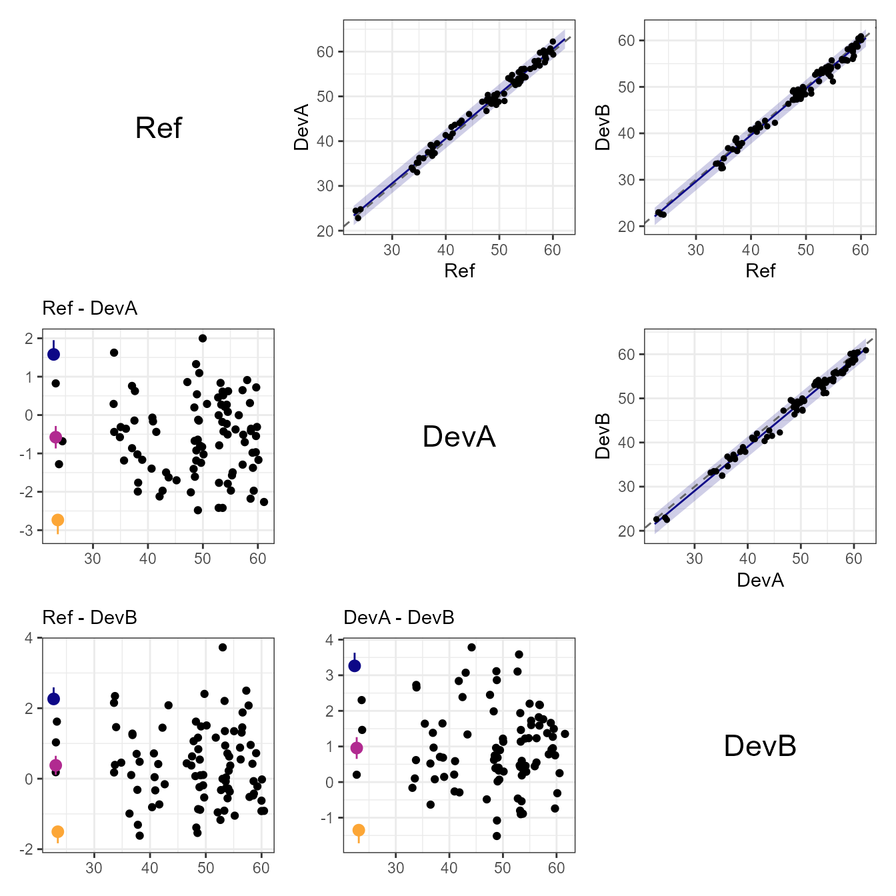
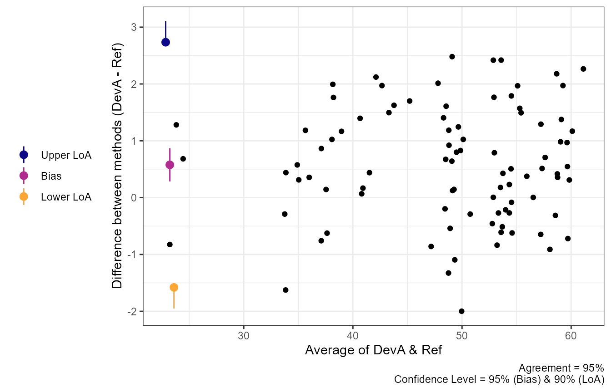
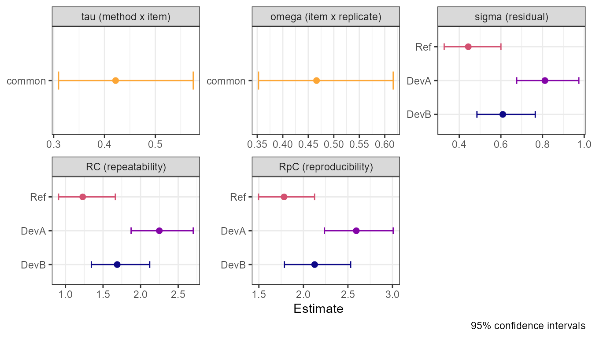
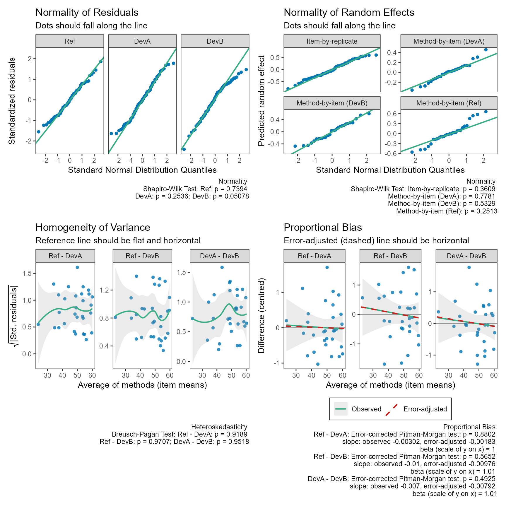

# Comparing Several Methods with Replicate Measurements

``` r

library(SimplyAgree)
```

[`agreement_limit()`](https://aaroncaldwell.us/SimplyAgree/reference/agreement_limit.md)
and
[`tolerance_limit()`](https://aaroncaldwell.us/SimplyAgree/reference/tolerance_limit.md)
compare **two** methods supplied as paired columns. When a study
measures each item with **several methods**, or measures it **more than
once with each method**, the variance component model of Carstensen et
al. ([2008](#ref-carstensen2008)) and Carstensen
([2010](#ref-carstensen2010)) uses all of the data in one model.
[`method_vc()`](https://aaroncaldwell.us/SimplyAgree/reference/method_vc.md)
fits that model and reports, for every pair of methods, the bias, the
limits of agreement (or tolerance limits), the variance components
behind them, and the repeatability of each method.

The data must be in the long format: one row per measurement, with
columns for the value, the method, the item (subject), and, with
replicates, the replicate.
[`mc_long()`](https://aaroncaldwell.us/SimplyAgree/reference/mc_long.md)
converts data with one column per method.

## Why paired differences are not enough with replicates

Limits of agreement describe the difference between **a single
measurement** by each method on a new item. With replicates, two
shortcuts are tempting, and both get this wrong:

- **Averaging the replicates** within each item before taking
  differences removes part of the measurement error, so the SD of the
  differences of the means is too *small* for single measurements.
- **Treating every replicate pair as an independent item** gets the SD
  about right, but the pairs from the same item are correlated, so the
  confidence intervals (and the bias SE) are too narrow, and the pairing
  of exchangeable replicates is arbitrary.

A small simulation shows the first problem. Two methods measure 40 items
3 times each. The `truth` attribute of simulated data holds the true SD
of the difference between single measurements.

``` r

dat = sim_methods(n_items = 40, n_reps = 3, methods = c("A", "B"),
                  alpha = c(0, 0.2), tau = 0.3, sigma = c(0.5, 0.7),
                  seed = 42)
attr(dat, "truth")$pairs
#> # A tibble: 1 × 7
#>   method1 method2  bias    sd lower_loa upper_loa constant_bias
#>   <chr>   <chr>   <dbl> <dbl>     <dbl>     <dbl> <lgl>        
#> 1 A       B        -0.2 0.959     -2.08      1.68 TRUE

# SD of the differences of the item means: too small
item_means = tapply(dat$y, list(dat$id, dat$method), mean)
sd(item_means[, "A"] - item_means[, "B"])
#> [1] 0.5968088

# the variance component model
fit_ab = method_vc(dat, y = "y", method = "method", id = "id",
                   replicate = "repl")
fit_ab$limits[, c("bias", "sd", "lower_loa", "upper_loa")]
#> # A tibble: 1 × 4
#>     bias    sd lower_loa upper_loa
#>    <dbl> <dbl>     <dbl>     <dbl>
#> 1 -0.348 0.883     -2.08      1.38
```

The model separates the variation of the method-by-item effects (`tau`)
from the measurement error of each method (`sigma`), and recombines them
for single measurements.

## Linked or exchangeable replicates?

This is a question about the **design**, not something to test from the
data ([Carstensen 2010](#ref-carstensen2010), ch. 5):

- **Exchangeable** (`replicates = "exchangeable"`, the default): the
  replicates of an item by one method are interchangeable, and replicate
  1 by method A has nothing more to do with replicate 1 by method B than
  with replicate 2. For example, each method measures a sample in random
  order, or on different days.
- **Linked** (`replicates = "linked"`): all methods measure the item on
  the same occasion, so replicate `r` is a shared occasion. For example,
  two oximeters read at the same time, three times per patient.
  Measurements on the same occasion share an item-by-replicate effect
  (`omega`) that does not affect the difference between methods on that
  occasion.

With linked replicates, `replicate` must identify the occasion in the
same way for all methods.

## The variance component model

For method \\m\\, item \\i\\, and replicate \\r\\,

\\ y\_{mir} = \alpha_m + \mu_i + a\_{ir} + c\_{mi} + e\_{mir}, \\

where

- \\\alpha_m\\ is the method mean, so \\\alpha_m - \alpha_k\\ is the
  **bias** between methods \\m\\ and \\k\\;
- \\\mu_i\\ are fixed item effects (no assumption about the distribution
  of the true values);
- \\c\_{mi} \sim N(0, \tau_m^2)\\ is the **method-by-item** interaction:
  the persistent deviation of method \\m\\ for item \\i\\ (a “matrix
  effect”); `tau = "common"` assumes one \\\tau\\ for all methods,
  `tau = "method"` (three or more methods) a separate one for each;
- \\a\_{ir} \sim N(0, \omega^2)\\ is the **item-by-replicate** effect
  (linked replicates only), shared by all methods on the same occasion;
- \\e\_{mir} \sim N(0, \sigma_m^2)\\ is the **measurement error** of
  method \\m\\.

The variance of the difference between single measurements by methods
\\m\\ and \\k\\ on a new item, on the same occasion, is

\\ V\_{mk} = \tau_m^2 + \tau_k^2 + \sigma_m^2 + \sigma_k^2 , \\

and the limits of agreement are \\\alpha_m - \alpha_k \pm z
\sqrt{V\_{mk}}\\. With linked replicates \\\omega\\ cancels, because
both methods share the occasion. If the methods would be applied on
different occasions in practice, `include_omega = TRUE` adds
\\2\omega^2\\.

Without replicates, the method-by-item variation cannot be separated
from the measurement error: with two methods only \\V\_{12}\\ can be
estimated (the classical paired-difference analysis, identical to
[`agreement_limit()`](https://aaroncaldwell.us/SimplyAgree/reference/agreement_limit.md)),
and with three or more methods the method-specific residual SDs absorb
\\\tau_m\\.

## A worked example: three methods, linked replicates

``` r

dat3 = sim_methods(n_items = 30, n_reps = 3,
                   methods = c("Ref", "DevA", "DevB"),
                   alpha = c(0, 0.6, -0.3), mu_mean = 50, mu_sd = 8,
                   tau = 0.5, omega = 0.6, sigma = c(0.4, 0.8, 0.6),
                   replicates = "linked", seed = 2024)
head(dat3)
#> # A tibble: 6 × 4
#>      id method  repl     y
#>   <int> <fct>  <int> <dbl>
#> 1     1 Ref        1  56.6
#> 2     1 Ref        2  57.6
#> 3     1 Ref        3  57.3
#> 4     1 DevA       1  57.9
#> 5     1 DevA       2  59.8
#> 6     1 DevA       3  58.0

fit = method_vc(dat3, y = "y", method = "method", id = "id",
                replicate = "repl", replicates = "linked")
fit
#> Variance Component Limits of Agreement (LoA)
#> 95% LoA @ 95% Confidence
#> Linked replicates; common method-by-item variance (tau) (30 items, 3 methods)
#> 
#>  Methods     Bias    Bias CI            Lower LoA Upper LoA LoA CI           
#>  Ref - DevA  -0.5774 [-0.8700, -0.2848] -2.7343   1.5795    [-3.1057, 1.9509]
#>  Ref - DevB   0.3793 [ 0.1095,  0.6491] -1.5044   2.2630    [-1.8325, 2.5911]
#>  DevA - DevB  0.9567 [ 0.6511,  1.2622] -1.3503   3.2637    [-1.7192, 3.6325]
#>  SD    
#>  1.1005
#>  0.9611
#>  1.1771
#> 
#> LoA CI: one-sided 95% bounds (outer ends of 90% CIs) for an intersection-union test;
#>   not a joint 95% interval for the LoA
#> 
#> Variance Components (SD)
#>  Component    SD     95% CI          
#>  tau          0.4218 [0.3097, 0.5745]
#>  omega        0.4662 [0.3525, 0.6165]
#>  sigma (Ref)  0.4435 [0.3277, 0.6002]
#>  sigma (DevA) 0.8115 [0.6759, 0.9742]
#>  sigma (DevB) 0.6092 [0.4851, 0.7651]
#> 
#> Repeatability Coefficients (95%)
#>  Method RC     RC CI            RpC    RpC CI          
#>  Ref    1.2293 [0.9083, 1.6636] 1.7835 [1.4963, 2.1257]
#>  DevA   2.2493 [1.8735, 2.7004] 2.5940 [2.2365, 3.0087]
#>  DevB   1.6886 [1.3445, 2.1207] 2.1263 [1.7866, 2.5306]
#> RC: limit for the difference between two measurements by a method under the same conditions
#> RpC: the same limit across replicate occasions (includes the item-by-replicate variation)
```

The printed table has one row per pair (first minus second method in the
order of the factor levels; the first level is the reference).
[`summary()`](https://rdrr.io/r/base/summary.html) adds the design, the
standard errors and degrees of freedom:

``` r

summary(fit)
#> Variance Component Model for Method Comparison
#> Model: method and item effects, random method-by-item and item-by-replicate effects, method-specific residual SDs (lme)
#> 
#> Design: number of items by method and number of replicates
#>  method  3
#>     Ref 30
#>    DevA 30
#>    DevB 30
#> 
#> Bias (method1 - method2)
#>  method1 method2    bias     se df lower.CL upper.CL
#>      Ref    DevA -0.5774 0.1462 58  -0.8700  -0.2848
#>      Ref    DevB  0.3793 0.1348 58   0.1095   0.6491
#>     DevA    DevB  0.9567 0.1526 58   0.6511   1.2622
#> 
#> Variance components (SD)
#>  component method     sd    var  lower  upper    df
#>        tau   <NA> 0.4218 0.1779 0.3097 0.5745 20.13
#>      omega   <NA> 0.4662 0.2173 0.3525 0.6165 24.59
#>      sigma    Ref 0.4435 0.1967 0.3277 0.6002 20.98
#>      sigma   DevA 0.8115 0.6585 0.6759 0.9742 57.48
#>      sigma   DevB 0.6092 0.3711 0.4851 0.7651 36.99
#> 
#> Limits of agreement (95%, iu bounds at 95% confidence)
#>  method1 method2    bias     sd df_sd lower_loa upper_loa lower_loa_ci
#>      Ref    DevA -0.5774 1.1005 102.0    -2.734     1.579       -3.106
#>      Ref    DevB  0.3793 0.9611 106.1    -1.504     2.263       -1.832
#>     DevA    DevB  0.9567 1.1771 124.8    -1.350     3.264       -1.719
#>  upper_loa_ci
#>         1.951
#>         2.591
#>         3.633
#> 
#> Repeatability
#>  method  sigma    rc rc_lower rc_upper   rpc rpc_lower rpc_upper
#>     Ref 0.4435 1.229   0.9083    1.664 1.783     1.496     2.126
#>    DevA 0.8115 2.249   1.8735    2.700 2.594     2.236     3.009
#>    DevB 0.6092 1.689   1.3445    2.121 2.126     1.787     2.531
```

[`confint()`](https://rdrr.io/r/stats/confint.html) gives the intervals
for the biases and the SDs, at any level:

``` r

confint(fit, level = 0.90)
#>                       5 %       95 %
#> bias_Ref-DevA  -0.8217098 -0.3330737
#> bias_Ref-DevB   0.1539622  0.6046065
#> bias_DevA-DevB  0.7015143  1.2118379
#> tau             0.3254752  0.5466527
#> omega           0.3687295  0.5894054
#> sigma_Ref       0.3440313  0.5716849
#> sigma_DevA      0.6960652  0.9460316
#> sigma_DevB      0.5031770  0.7375923
```

[`model_equation()`](https://aaroncaldwell.us/SimplyAgree/reference/model_equation.md)
writes the fitted model with its estimates:

``` r

model_equation(fit, use_coefs = TRUE)
```

\\ \begin{aligned} y\_{mir} &= \alpha\_{m} + \mu\_{i} + a\_{ir} +
c\_{mi} + e\_{mir}, \quad \alpha\_{\mathrm{Ref}} = 48.442,\\
\alpha\_{\mathrm{DevA}} = 49.019,\\ \alpha\_{\mathrm{DevB}} = 48.063 \\
a\_{ir} &\sim N(0,\\ 0.466^{2}), \quad c\_{mi} \sim N(0,\\ 0.422^{2}) \\
e\_{mir} &\sim N(0,\\ \sigma^{2}\_{m}), \quad \sigma\_{\mathrm{Ref}} =
0.443,\\ \sigma\_{\mathrm{DevA}} = 0.811,\\ \sigma\_{\mathrm{DevB}} =
0.609 \\ & \textstyle\sum\_{i} \mu\_{i} = 0 \end{aligned} \\

The matrix plot shows every pair. Above the diagonal each method is
plotted against the other, with the line of identity (dashed) and the
constant-bias conversion line with its prediction limits; below the
diagonal are the Bland-Altman plots.

``` r

plot(fit, type = "matrix", pair_seed = 1)
```



A single pair can be plotted in either direction. As in
[`agreement_limit()`](https://aaroncaldwell.us/SimplyAgree/reference/agreement_limit.md),
the bias and limits are drawn to the left of the data, with their
confidence intervals; `delta` adds a maximal allowable difference and
`geom` changes how the data are shown.

``` r

plot(fit, pair = c("DevA", "Ref"))
```



The variance components, with confidence intervals, and the
repeatability coefficients:

``` r

plot(fit, type = "vc")
```



The confidence intervals for the SDs come from the approximate
covariance of the variance parameters of the fitted model (Wald
intervals on the log scale). The SD of each difference gets
Satterthwaite degrees of freedom (`df_sd`) from the same covariance,
which accounts for the correlation between the estimated components.

## Agreement or tolerance limits

`interval = "agreement"` (default) gives the limits of agreement with
confidence bounds computed by the MOVER ([Donner and Zou
2012](#ref-donner2012closed)), as in
[`agreement_limit()`](https://aaroncaldwell.us/SimplyAgree/reference/agreement_limit.md).
`interval = "tolerance"` gives prediction limits and tolerance limits as
in
[`tolerance_limit()`](https://aaroncaldwell.us/SimplyAgree/reference/tolerance_limit.md):
the prediction limits are expected to contain a single new difference
with probability `pred_level`, and the tolerance limits are their
confidence bounds. `bound_type` has the same meaning in both, and in
tolerance mode it affects only the tolerance limits:

- `"iu"`: a one-sided `conf_level` bound on each limit; use for an
  intersection-union test of whether both limits lie within a maximal
  allowable difference. These are not a joint interval. The default for
  agreement.
- `"joint"`: joint confidence for both limits (agreement), or a
  `pred_level`-content, `conf_level`-confidence tolerance interval: with
  confidence `conf_level`, at least `pred_level` of the differences lie
  within the limits. The default for tolerance.

``` r

method_vc(dat3, y = "y", method = "method", id = "id",
          replicate = "repl", replicates = "linked",
          interval = "tolerance")
#> Variance Component Prediction and Tolerance Limits
#> 95% Content @ 95% Confidence
#> Linked replicates; common method-by-item variance (tau) (30 items, 3 methods)
#> 
#>  Methods     Bias    Bias CI            Prediction Interval Tolerance Limits 
#>  Ref - DevA  -0.5774 [-0.8700, -0.2848] [-2.7793, 1.6245]   [-3.0388, 1.8840]
#>  Ref - DevB   0.3793 [ 0.1095,  0.6491] [-1.5448, 2.3033]   [-1.7670, 2.5256]
#>  DevA - DevB  0.9567 [ 0.6511,  1.2622] [-1.3924, 3.3058]   [-1.6421, 3.5555]
#>  SD    
#>  1.1005
#>  0.9611
#>  1.1771
#> 
#> Prediction interval: expected to contain a single new difference with probability 95%
#> Tolerance limits: with 95% confidence, at least 95% of differences lie within the limits
#> 
#> Variance Components (SD)
#>  Component    SD     95% CI          
#>  tau          0.4218 [0.3097, 0.5745]
#>  omega        0.4662 [0.3525, 0.6165]
#>  sigma (Ref)  0.4435 [0.3277, 0.6002]
#>  sigma (DevA) 0.8115 [0.6759, 0.9742]
#>  sigma (DevB) 0.6092 [0.4851, 0.7651]
#> 
#> Repeatability Coefficients (95%)
#>  Method RC     RC CI            RpC    RpC CI          
#>  Ref    1.2293 [0.9083, 1.6636] 1.7835 [1.4963, 2.1257]
#>  DevA   2.2493 [1.8735, 2.7004] 2.5940 [2.2365, 3.0087]
#>  DevB   1.6886 [1.3445, 2.1207] 2.1263 [1.7866, 2.5306]
#> RC: limit for the difference between two measurements by a method under the same conditions
#> RpC: the same limit across replicate occasions (includes the item-by-replicate variation)
```

The bounds rely on large-sample approximations for the variance
components. In simulations with 15 to 60 items, 2 or 3 replicates, and 2
or 3 methods (95% targets), the one-sided bounds of the limits of
agreement covered the true limits 92% to 96% of the time, and the joint
tolerance limits 92% to 96%. Coverage was lowest (about 91% to 93%) with
only 15 items, so with few items the bounds should be read as slightly
optimistic.

### A note on MethComp’s multiplier of 2

MethComp, and the examples in Carstensen ([2010](#ref-carstensen2010)),
compute the limits of agreement as the bias \\\pm 2\\ SD, so
[`method_vc()`](https://aaroncaldwell.us/SimplyAgree/reference/method_vc.md)
with the defaults gives limits about 2% narrower than MethComp. The 2 is
a rounded multiplier. It is somewhat larger than \\z\_{0.975} = 1.96\\,
which leaves some room for the uncertainty in the estimated SD, but it
does not correspond to a stated coverage or confidence. SimplyAgree
keeps the two parts separate: \\z\\ (from `pred_level`) defines the
limits as percentiles of the differences, and the uncertainty in
estimating them is stated explicitly by the confidence bounds
(`conf_level`) or by tolerance limits. With 30 differences, for example,
accounting for that uncertainty gives a multiplier of about 2.55 (a
95%-content, 95%-confidence tolerance interval) to 2.61 (one-sided 95%
bounds on each limit), well beyond 2; see
[`vignette("agreement_analysis")`](https://aaroncaldwell.us/SimplyAgree/articles/agreement_analysis.md).

To reproduce MethComp’s limits and repeatability coefficients, choose
`pred_level` so that \\z = 2\\, i.e., `pred_level = 2 * pnorm(2) - 1`
(about 95.45%):

``` r

method_vc(dat3, y = "y", method = "method", id = "id",
          replicate = "repl", replicates = "linked",
          pred_level = 2 * pnorm(2) - 1)$limits[, c("method1", "method2",
                                                    "lower_loa", "upper_loa")]
#> # A tibble: 3 × 4
#>   method1 method2 lower_loa upper_loa
#>   <chr>   <chr>       <dbl>     <dbl>
#> 1 Ref     DevA        -2.78      1.62
#> 2 Ref     DevB        -1.54      2.30
#> 3 DevA    DevB        -1.40      3.31
```

## Repeatability and reproducibility

With replicates, each method’s measurement error gives its
**repeatability coefficient** ([Carstensen 2010](#ref-carstensen2010),
ch. 9),

\\ RC_m = z \sqrt{2}\\ \sigma_m , \\

the value that the absolute difference between two measurements by the
method on the same item, under the same conditions, should not exceed
with probability `pred_level` (about \\2.77\sigma_m\\ for 95%). With
linked replicates, the **reproducibility coefficient** \\RpC_m =
z\sqrt{2}\sqrt{\sigma_m^2 + \omega^2}\\ is the same limit for two
measurements on different occasions.

``` r

fit$repeatability
#> # A tibble: 3 × 8
#>   method sigma    rc rc_lower rc_upper   rpc rpc_lower rpc_upper
#>   <chr>  <dbl> <dbl>    <dbl>    <dbl> <dbl>     <dbl>     <dbl>
#> 1 Ref    0.443  1.23    0.908     1.66  1.78      1.50      2.13
#> 2 DevA   0.811  2.25    1.87      2.70  2.59      2.24      3.01
#> 3 DevB   0.609  1.69    1.34      2.12  2.13      1.79      2.53
```

The confidence limits of \\RC_m\\ are those of \\\sigma_m\\, scaled.
When \\\omega\\ is large relative to \\\sigma_m\\, the two are hard to
separate and the interval for \\\sigma_m\\ is wide.

## Transformations

All estimates are computed on the scale set by `transform`. With
`transform = "log"`, the differences are log ratios: the biases and
limits are printed as ratios, and the SD is approximately the
coefficient of variation.

``` r

dat_log = sim_methods(n_items = 40, n_reps = 2, methods = c("A", "B"),
                      alpha = c(0, 0.05), mu_mean = 4, mu_sd = 0.5,
                      tau = 0.04, sigma = c(0.05, 0.08),
                      transform = "log", seed = 3)
method_vc(dat_log, y = "y", method = "method", id = "id",
          replicate = "repl", transform = "log")
#> Variance Component Limits of Agreement (LoA) of the Ratio
#> 95% LoA @ 95% Confidence
#> Exchangeable replicates; common method-by-item variance (tau) (40 items, 2 methods)
#> Transformation: log
#> 
#>  Methods Bias  Bias CI          Lower LoA Upper LoA LoA CI           SD    
#>  A / B   0.959 [0.9299, 0.9891] 0.7617    1.2073    [0.7292, 1.2612] 0.1175
#> 
#> LoA CI: one-sided 95% bounds (outer ends of 90% CIs) for an intersection-union test;
#>   not a joint 95% interval for the LoA
#> Bias and limits are ratios (exp of the log-scale estimates); SD is on the log scale (approximately the CV)
#> 
#> Variance Components (SD, log scale)
#>  Component SD     95% CI          
#>  tau       0.0490 [0.0311, 0.0773]
#>  sigma (A) 0.0583 [0.0468, 0.0727]
#>  sigma (B) 0.0748 [0.0601, 0.0932]
#> 
#> Repeatability Coefficients (95%, log scale)
#>  Method RC     RC CI           
#>  A      0.1617 [0.1298, 0.2014]
#>  B      0.2073 [0.1665, 0.2582]
#> RC: limit for the difference between two measurements by a method under the same conditions
```

For measurements bounded between 0 and 100 (e.g., oxygen saturation),
`transform = "pctlogit"` analyzes the logit of the proportion
([Carstensen 2010](#ref-carstensen2010), ch. 8). Other options are
`"logit"`, `"sqrt"`, `"asinsqrt"`, or a custom pair of functions,
`list(fun = ..., inv = ..., name = ...)`. The Bland-Altman and matrix
plots back-transform the conversion lines to the original scale.

### Interpreting results on a transformed scale

With a transformation other than `"log"`, the printed bias and limits
stay on the transformed scale. On the `"pctlogit"` scale,
\\\mathrm{logit}(y/100) = \log\\y/(100 - y)\\\\, so a difference between
methods is a difference in log odds: \\\exp(\text{bias})\\ is the ratio
of the odds of the two methods, and the limits of agreement are limits
for that odds ratio. That is correct, but rarely a useful way to report
agreement.

A constant bias on the logit scale is not constant in percentage points:
it is largest near 50% and shrinks toward 0 and 100. This is the point
of the transformation, but it means there is no single bias or pair of
limits “in percent”. They have to be stated at a level.

``` r

sat = sim_methods(n_items = 40, n_reps = 2, methods = c("Ref", "New"),
                  alpha = c(0, -0.15), mu_mean = 1.5, mu_sd = 0.8,
                  tau = 0.15, sigma = c(0.12, 0.18),
                  transform = "pctlogit", seed = 7)
fit_sat = method_vc(sat, y = "y", method = "method", id = "id",
                    replicate = "repl", transform = "pctlogit")
fit_sat
#> Variance Component Limits of Agreement (LoA)
#> 95% LoA @ 95% Confidence
#> Exchangeable replicates; common method-by-item variance (tau) (40 items, 2 methods)
#> Transformation: pctlogit
#> 
#>  Methods   Bias   Bias CI         Lower LoA Upper LoA LoA CI            SD    
#>  Ref - New 0.1253 [0.0435, 0.207] -0.4753   0.7259    [-0.5926, 0.8431] 0.3064
#> 
#> LoA CI: one-sided 95% bounds (outer ends of 90% CIs) for an intersection-union test;
#>   not a joint 95% interval for the LoA
#> Estimates are on the pctlogit scale; print(x, scale = "original") gives them in original units.
#> 
#> Variance Components (SD, pctlogit scale)
#>  Component   SD     95% CI          
#>  tau         0.1354 [0.0891, 0.2059]
#>  sigma (Ref) 0.1100 [0.0884, 0.1370]
#>  sigma (New) 0.2124 [0.1706, 0.2644]
#> 
#> Repeatability Coefficients (95%, pctlogit scale)
#>  Method RC     RC CI           
#>  Ref    0.3050 [0.2450, 0.3797]
#>  New    0.5887 [0.4729, 0.7328]
#> RC: limit for the difference between two measurements by a method under the same conditions
```

On the analysis scale, the bias \\b\\ (Ref minus New) means that Ref’s
odds are \\\exp(b)\\ times New’s.

#### Limits of agreement in original units

Often the question is simply where the differences between the two
methods fall, in the units of the measurement, without treating either
method as the reference. `print(scale = "original")` answers this at a
given level. A difference \\d\\ on the analysis scale between two
measurements whose average (on that scale) is \\t\\ corresponds to

\\ h(d) = g^{-1}(t + d/2) - g^{-1}(t - d/2) \\

in original units, where \\g^{-1}\\ is the inverse transformation. At a
fixed level, \\h\\ is increasing in \\d\\, so the limits and their
confidence bounds carry over exactly, with the same coverage and
confidence. The back-transformed bias is the median difference at that
level, not the mean. By default the level is the median of the item
averages:

``` r

print(fit_sat, scale = "original")
#> Variance Component Limits of Agreement (LoA)
#> 95% LoA @ 95% Confidence
#> Exchangeable replicates; common method-by-item variance (tau) (40 items, 2 methods)
#> Transformation: pctlogit
#> 
#>  Methods   At      Bias   Bias CI         Lower LoA Upper LoA
#>  Ref - New 82.1714 1.8353 [0.6379, 3.033] -6.9714   10.6609  
#>  LoA CI            
#>  [-8.6964, 12.3934]
#> 
#> LoA CI: one-sided 95% bounds (outer ends of 90% CIs) for an intersection-union test;
#>   not a joint 95% interval for the LoA
#> Original scale (back-transformed from pctlogit) at 82.1714, the median of the item averages;
#>   differences centered on that level; Bias is the median difference there
#> 
#> Variance Components (SD, pctlogit scale)
#>  Component   SD     95% CI          
#>  tau         0.1354 [0.0891, 0.2059]
#>  sigma (Ref) 0.1100 [0.0884, 0.1370]
#>  sigma (New) 0.2124 [0.1706, 0.2644]
#> 
#> Repeatability Coefficients (95%, original scale)
#>  Method At      RC     RC CI            
#>  Ref    82.1714 4.4708 [3.5907,  5.5671]
#>  New    82.1714 8.6384 [6.9349, 10.7634]
#> RC: limit for the difference between two measurements by a method under the same conditions
```

For a full picture, give the levels that matter in practice (supplying
`at` implies `scale = "original"`):

``` r

print(fit_sat, at = c(70, 90, 98))
#> Variance Component Limits of Agreement (LoA)
#> 95% LoA @ 95% Confidence
#> Exchangeable replicates; common method-by-item variance (tau) (40 items, 2 methods)
#> Transformation: pctlogit
#> 
#>  Methods   At Bias   Bias CI          Lower LoA Upper LoA LoA CI             
#>  Ref - New 70 2.6301 [0.9144, 4.3447] -9.9576   15.1561   [-12.3971, 17.5693]
#>  Ref - New 90 1.1277 [0.3919, 1.8644] -4.2964    6.5981   [ -5.3690,  7.6900]
#>  Ref - New 98 0.2457 [0.0853, 0.4063] -0.9394    1.4503   [ -1.1765,  1.6959]
#> 
#> LoA CI: one-sided 95% bounds (outer ends of 90% CIs) for an intersection-union test;
#>   not a joint 95% interval for the LoA
#> Original scale (back-transformed from pctlogit) at the levels in 'At';
#>   differences centered on that level; Bias is the median difference there
#> 
#> Variance Components (SD, pctlogit scale)
#>  Component   SD     95% CI          
#>  tau         0.1354 [0.0891, 0.2059]
#>  sigma (Ref) 0.1100 [0.0884, 0.1370]
#>  sigma (New) 0.2124 [0.1706, 0.2644]
#> 
#> Repeatability Coefficients (95%, original scale)
#>  Method At RC      RC CI            
#>  Ref    70  6.3992 [5.1422,  7.9619]
#>  New    70 12.3153 [9.9058, 15.2995]
#>  Ref    90  2.7502 [2.2078,  3.4270]
#>  New    90  5.3328 [4.2738,  6.6625]
#>  Ref    98  0.5999 [0.4813,  0.7482]
#>  New    98  1.1685 [0.9344,  1.4648]
#> RC: limit for the difference between two measurements by a method under the same conditions
```

So, for example, “at a saturation of about 90%, the two methods differ
by between about −4.3 and +6.6 percentage points, and by about ±1 point
near 98%”. The repeatability coefficients are converted in the same way.
The variance components are still reported on the analysis scale,
because they do not translate into a single number in original units.
The conversion panels of `plot(fit_sat, type = "matrix")` show the
back-transformed conversion and prediction limits over the whole range.

A single pair of limits “averaged” over all the items would depend on
the mix of levels in the sample and would hide how the agreement changes
with the level, so it is not offered. When the range of the data is
narrow enough that the spread of the differences is roughly constant
(check with
[`check()`](https://aaroncaldwell.us/SimplyAgree/reference/simple_agree-methods.md)),
an analysis without a transformation answers the question directly.

#### Converting from one method to the other

[`predict()`](https://rdrr.io/r/stats/predict.html) answers a different,
directional question: given a reading by New, what would Ref read? It
starts from the measurement by one method rather than from the average
of the two, and returns the converted value with prediction limits (the
bias \\\pm z\\ SD, back-transformed):

``` r

predict(fit_sat, newdata = c(70, 90, 98), from = "New", to = "Ref")
#> # A tibble: 3 × 4
#>   from_value   fit lower upper
#>        <dbl> <dbl> <dbl> <dbl>
#> 1         70  72.6  59.2  82.8
#> 2         90  91.1  84.8  94.9
#> 3         98  98.2  96.8  99.0
```

When New reads 90%, Ref is expected to read `fit` and, for `pred_level`
of items, lies between `lower` and `upper`.

## Checking the model

[`check()`](https://aaroncaldwell.us/SimplyAgree/reference/simple_agree-methods.md)
returns diagnostic plots in the style of
[`check()`](https://aaroncaldwell.us/SimplyAgree/reference/simple_agree-methods.md)
for
[`agreement_limit()`](https://aaroncaldwell.us/SimplyAgree/reference/agreement_limit.md),
each with a subtitle saying what to look for and its test in the
caption: normal QQ plots of the residuals by method and of the predicted
random effects (Shapiro-Wilk tests), and, for each pair, the homogeneity
of variance of the differences (Breusch-Pagan test) and proportional
bias (the centred differences against the averages). The tests for each
pair use the item means, so replicates are not counted more than once.
With exchangeable replicates the measurements are paired at random, so
set `pair_seed` for reproducible p-values.

``` r

check(fit, pair_seed = 1)
```



- If the **spread** of the differences grows with the level, try a
  transformation, such as `transform = "log"`.
- If the **bias** depends on the level, a constant bias is not adequate,
  and the methods are related by a slope as well as an intercept. But a
  slope of the differences on the averages also appears when the two
  methods have unequal measurement error alone, because
  \\\mathrm{cov}(D, A) = (\mathrm{var}(y_1) - \mathrm{var}(y_2))/2\\
  ([Bland and Altman 1999](#ref-bland1999)). With replicates,
  [`check()`](https://aaroncaldwell.us/SimplyAgree/reference/simple_agree-methods.md)
  therefore corrects the test for each method’s measurement error,
  estimated from the replicates (the error-corrected Pitman-Morgan
  test), and draws the error-adjusted slope as a dashed line. Only a
  significant *corrected* test is evidence that the methods differ in
  scale; the scaled model of Carstensen ([2010](#ref-carstensen2010),
  ch. 7) (`method_convert(bias = "scaled")`) then estimates the
  relation. Without replicates the test cannot separate the two, and
  [`check()`](https://aaroncaldwell.us/SimplyAgree/reference/simple_agree-methods.md)
  says so. With method-specific `tau`, the difference in method-by-item
  variances is also removed.

The results for each pair are attached to the output as the attribute
`"prop_bias"`; `beta` is the scale of the second method of the pair
relative to the first implied by the error-adjusted slope.

``` r

attr(check(fit, pair_seed = 1), "prop_bias")[, c("group", "p.value",
                                                  "p.uncorrected", "beta")]
#>         group   p.value p.uncorrected     beta
#> 1  Ref - DevA 0.8801739     0.8269011 1.001831
#> 2  Ref - DevB 0.5651662     0.5782736 1.009806
#> 3 DevA - DevB 0.4924542     0.6366668 1.007947
```

See the “Proportional Bias” section of
[`vignette("agreement_analysis")`](https://aaroncaldwell.us/SimplyAgree/articles/agreement_analysis.md)
for how to read the plot and what to do with the result.

## References

Bland, J Martin, and Douglas G Altman. 1999. “Measuring Agreement in
Method Comparison Studies.” *Statistical Methods in Medical Research* 8
(2): 135–60. <https://doi.org/10.1177/096228029900800204>.

Carstensen, Bendix. 2010. *Comparing Clinical Measurement Methods: A
Practical Guide*. Wiley. <https://doi.org/10.1002/9780470683019>.

Carstensen, Bendix, Julie Simpson, and Lyle C Gurrin. 2008. “Statistical
Models for Assessing Agreement in Method Comparison Studies with
Replicate Measurements.” *The International Journal of Biostatistics* 4
(1). <https://doi.org/10.2202/1557-4679.1107>.

Donner, Allan, and GY Zou. 2012. “Closed-Form Confidence Intervals for
Functions of the Normal Mean and Standard Deviation.” *Statistical
Methods in Medical Research* 21 (4): 347–59.
