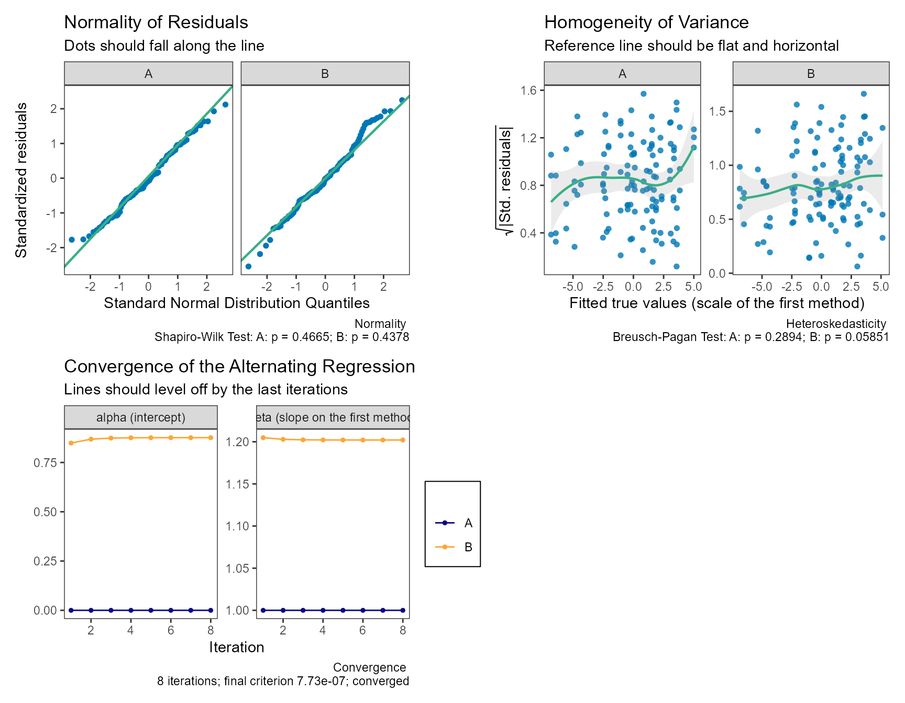
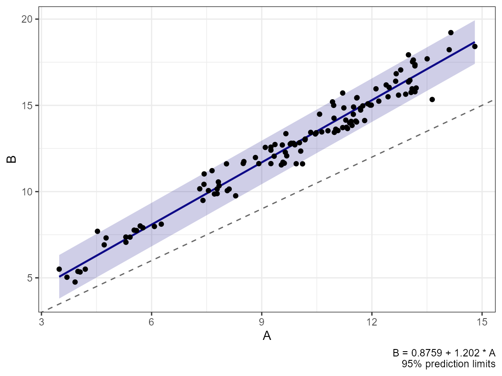
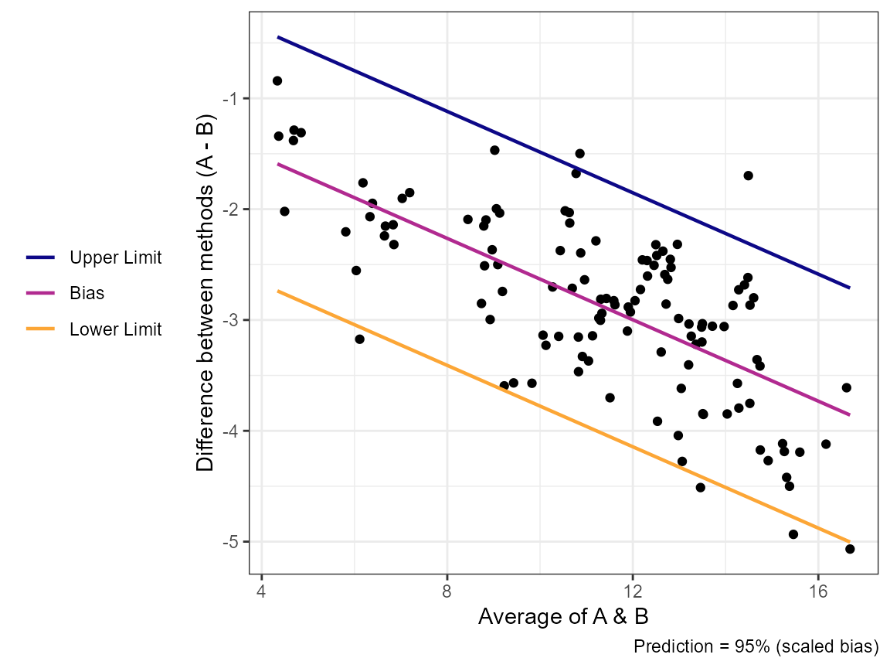
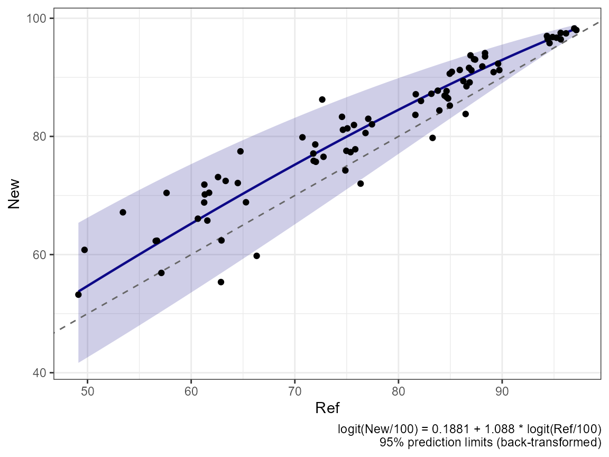

# Converting Between Methods

``` r

library(SimplyAgree)
```

Limits of agreement answer “how far apart are two methods?”. When the
methods do not agree, the next question is often “what would method B
have read, given a measurement by method A?”.
[`method_convert()`](https://aaroncaldwell.us/SimplyAgree/reference/method_convert.md)
estimates **conversion equations** between every pair of methods,

\\ y\_{\text{to}} = \alpha\_{\text{to}\|\text{from}} +
\beta\_{\text{to}\|\text{from}}\\ y\_{\text{from}}, \\

with a prediction SD and prediction limits, under three models for the
bias between methods ([Carstensen 2010](#ref-carstensen2010)). The data
are in the long format used by
[`method_vc()`](https://aaroncaldwell.us/SimplyAgree/reference/method_vc.md)
(see
[`vignette("method_comparison_vc")`](https://aaroncaldwell.us/SimplyAgree/articles/method_comparison_vc.md)).

We use simulated data throughout. Method B reads about 1 unit higher and
20% steeper than method A (\\\beta_B = 1.2\\), so the bias is not
constant:

``` r

dat = sim_methods(n_items = 40, n_reps = 3, methods = c("A", "B"),
                  alpha = c(0, 1), beta = c(1, 1.2),
                  mu_mean = 10, mu_sd = 3, tau = 0.2,
                  sigma = c(0.3, 0.5), seed = 101)
attr(dat, "truth")$conversion
#> # A tibble: 4 × 5
#>   to    from   alpha  beta sd_pred
#>   <chr> <chr>  <dbl> <dbl>   <dbl>
#> 1 A     A      0     1       0.424
#> 2 A     B     -0.833 0.833   0.586
#> 3 B     A      1     1.2     0.703
#> 4 B     B      0     1       0.707
```

## Constant bias: from a variance component fit

If the bias is constant, the conversion has slope 1 and its intercept is
the bias, so it follows directly from
[`method_vc()`](https://aaroncaldwell.us/SimplyAgree/reference/method_vc.md).
The prediction SD is the SD of the difference between single
measurements, and, for a method converted to itself,
\\\sqrt{2}\sigma_m\\ (two measurements by the same method).

``` r

fit_vc = method_vc(dat, y = "y", method = "method", id = "id",
                   replicate = "repl")
conv_const = method_convert(object = fit_vc)
conv_const
#> Conversion Between Methods: Constant Bias
#> y(To) = alpha + beta * y(From); sd = prediction SD
#> 
#>  To From alpha   95% CI             beta 95% CI sd    
#>  A  A     0.0000                    1           0.3747
#>  A  B    -2.8711 [-3.0867, -2.6555] 1           0.8220
#>  B  A     2.8711 [ 2.6555,  3.0867] 1           0.8220
#>  B  B     0.0000                    1           0.7232
#> 
#> From method_vc(): slope fixed at 1; intercept CIs are those of the biases
```

[`predict()`](https://rdrr.io/r/stats/predict.html) on the
[`method_vc()`](https://aaroncaldwell.us/SimplyAgree/reference/method_vc.md)
fit does the same thing:

``` r

predict(fit_vc, newdata = c(5, 10, 15), from = "A", to = "B")
#> # A tibble: 3 × 4
#>   from_value   fit lower upper
#>        <dbl> <dbl> <dbl> <dbl>
#> 1          5  7.87  6.26  9.48
#> 2         10 12.9  11.3  14.5 
#> 3         15 17.9  16.3  19.5
```

Here the constant bias is a poor description: `check(fit_vc)` shows the
differences changing with the level.

## Linear bias: differences on averages

The classical approach ([Bland and Altman 1999](#ref-bland1999);
[Carstensen 2010, sec. 4.7](#ref-carstensen2010)) regresses the
differences \\D = y_1 - y_2\\ on the averages \\A = (y_1 + y_2)/2\\ for
each pair,

\\ D = a + bA + e, \\

and rearranges the fitted line into a conversion equation, \\y_1 =
a/(1 - b/2) + y_2 (1 + b/2)/(1 - b/2)\\. The prediction limits are the
limits of the differences, transformed the same way.

``` r

conv_lin = method_convert(dat, y = "y", method = "method", id = "id",
                          replicate = "repl", pair_seed = 1)
conv_lin
#> Conversion Between Methods: Linear Bias
#> y(To) = alpha + beta * y(From); sd = prediction SD
#> Regression of differences on averages, constant SD of the differences
#> 
#>  To From alpha   95% CI             beta   95% CI           sd    
#>  A  A     0.0000                    1.0000                        
#>  A  B    -0.6394 [-1.0718, -0.2070] 0.8249 [0.7910, 0.8587] 0.5480
#>  B  A     0.7751 [ 0.2816,  1.2686] 1.2123 [1.1625, 1.2621] 0.6644
#>  B  B     0.0000                    1.0000                        
#> 
#> CIs: approximate (delta method, cluster-robust by item)
#> A slope of the differences on the averages can arise from unequal measurement errors alone;
#>   see ?method_convert
```

With replicates, each item contributes several pairs (exchangeable
replicates are paired at random within item; `pair_seed` makes this
reproducible), so the standard errors are cluster-robust by item.

If the spread of the differences also changes with the level,
`variance = "linear"` models the SD of the differences as a linear
function of the average:

``` r

method_convert(dat, y = "y", method = "method", id = "id",
               replicate = "repl", pair_seed = 1, variance = "linear")
#> Conversion Between Methods: Linear Bias
#> y(To) = alpha + beta * y(From); sd = prediction SD
#> Regression of differences on averages, linear SD of the differences
#> 
#>  To From alpha   95% CI             beta   95% CI           sd
#>  A  A     0.0000                    1.0000                    
#>  A  B    -0.6394 [-1.0718, -0.2070] 0.8249 [0.7910, 0.8587]   
#>  B  A     0.7751 [ 0.2816,  1.2686] 1.2123 [1.1625, 1.2621]   
#>  B  B     0.0000                    1.0000                    
#> 
#> CIs: approximate (delta method, cluster-robust by item)
#> Prediction SD depends on the level; SD of the differences:
#>   A - B: 0.2283 + 0.0339 * average
#> A slope of the differences on the averages can arise from unequal measurement errors alone;
#>   see ?method_convert
```

**A caveat.** The slope \\b\\ is biased whenever the two methods have
different measurement errors, because \\\mathrm{cov}(D, A) =
(\mathrm{var}(y_1) - \mathrm{var}(y_2))/2\\: two methods with the same
scale but different precision show a “proportional bias” on this plot.
In these data method B is noisier than A, which pushes \\b\\ away from
its true value. The scaled model below, or errors-in-variables
regression
([`dem_reg()`](https://aaroncaldwell.us/SimplyAgree/reference/dem_reg.md),
[`pb_reg()`](https://aaroncaldwell.us/SimplyAgree/reference/pb_reg.md)),
accounts for the measurement errors.

## The scaled model

The scaled model ([Carstensen 2010](#ref-carstensen2010), ch. 7) assumes
that every method measures the same true value \\\mu_i\\ on its own
linear scale,

\\ y\_{mir} = \alpha_m + \beta_m(\mu_i + a\_{ir} + c\_{mi}) + e\_{mir},
\\

with the variance components of
[`method_vc()`](https://aaroncaldwell.us/SimplyAgree/reference/method_vc.md):
method-by-item effects \\c\_{mi}\\, item-by-replicate effects
\\a\_{ir}\\ (linked replicates), and measurement errors \\e\_{mir}\\
with a separate SD for each method. The conversion from method \\m\\ to
method \\k\\ is

\\ \beta\_{k\|m} = \beta_k/\beta_m, \qquad \alpha\_{k\|m} = \alpha_k -
\alpha_m \beta_k/\beta_m . \\

`method_convert(bias = "scaled")` fits this model by alternating
regression (the default, `estimator = "altreg"`), as in MethComp’s
`AltReg()`: it alternates between regressing each method on the current
predicted true values and refitting the variance component model to the
rescaled measurements, until the conversions stop changing. It needs
replicates, to separate the measurement errors from the method-by-item
variation. For confidence intervals, use the maximum likelihood fit
instead (`estimator = "ml"`; see
[below](#confidence-intervals-for-the-scaled-model)).

``` r

conv_sc = method_convert(dat, y = "y", method = "method", id = "id",
                         replicate = "repl", bias = "scaled")
conv_sc
#> Conversion Between Methods: Scaled Model
#> y(To) = alpha + beta * y(From); sd = prediction SD
#> 
#>  To From alpha   95% CI             beta   95% CI           sd    
#>  A  A     0.0000                    1.0000                  0.3747
#>  A  B    -0.7286 [-1.0634, -0.3939] 0.8319 [0.8064, 0.8573] 0.5355
#>  B  A     0.8759 [ 0.4994,  1.2524] 1.2021 [1.1653, 1.2389] 0.6437
#>  B  B     0.0000                    1.0000                  0.7232
#> 
#> CIs: delta method, conditional on the predicted true values;
#>   much too narrow (about 55-75% coverage for 95% in simulations);
#>   use estimator = 'ml' for intervals; see ?method_convert
#> Alternating regression: 8 iterations, converged (criterion 7.73e-07)
#> 
#> Variance components (SD, on each method's scale)
#>  Method tau    sigma 
#>  A      0.1334 0.2650
#>  B      0.1603 0.5114
```

The slope of B on A is close to the true 1.2.
[`summary()`](https://rdrr.io/r/base/summary.html) shows the per-method
intercepts and slopes, with the first method as the reference (\\\alpha
= 0\\, \\\beta = 1\\); only the conversions between methods are
identified, not the scale of the true values.

``` r

summary(conv_sc)$scaled$methods
#> # A tibble: 2 × 3
#>   method alpha  beta
#>   <chr>  <dbl> <dbl>
#> 1 A      0      1   
#> 2 B      0.876  1.20
```

[`check()`](https://aaroncaldwell.us/SimplyAgree/reference/simple_agree-methods.md)
shows the residuals of the final variance component model (their
normality, with Shapiro-Wilk tests, and their spread against the fitted
true values, with Breusch-Pagan tests) and how the estimates converged:

``` r

check(conv_sc)
```



The conversion plot shows the conversion and its prediction limits with
the observed pairs; the dashed line is the line of identity.

``` r

plot(conv_sc)
```



The Bland-Altman plot shows the bias and prediction limits that the
model implies for the differences, as lines that change with the level:

``` r

plot(conv_sc, type = "ba")
```



## Transformed scales

All three models are fit on the scale set by `transform` (see
[`vignette("method_comparison_vc")`](https://aaroncaldwell.us/SimplyAgree/articles/method_comparison_vc.md)).
The conversions are then linear on that scale, and
[`predict()`](https://rdrr.io/r/stats/predict.html) and the conversion
plot back-transform the converted value and its prediction limits to the
original scale ([Carstensen 2010](#ref-carstensen2010), ch. 8). For
percentages (e.g., oxygen saturation), `transform = "pctlogit"` keeps
the conversions and limits inside 0 to 100:

``` r

sat = sim_methods(n_items = 40, n_reps = 2, methods = c("Ref", "New"),
                  alpha = c(0, 0.15), beta = c(1, 1.1), mu_mean = 1.2,
                  mu_sd = 0.8, tau = 0.1, sigma = c(0.1, 0.15),
                  transform = "pctlogit", seed = 7)
conv_sat = method_convert(sat, y = "y", method = "method", id = "id",
                          replicate = "repl", bias = "scaled",
                          transform = "pctlogit")
predict(conv_sat, newdata = c(60, 80, 95, 99), from = "Ref", to = "New")
#> # A tibble: 4 × 4
#>   from_value   fit lower upper
#>        <dbl> <dbl> <dbl> <dbl>
#> 1         60  65.2  53.6  75.3
#> 2         80  84.5  77.0  89.9
#> 3         95  96.7  94.8  98.0
#> 4         99  99.4  99.1  99.7
plot(conv_sat, pair = c("Ref", "New"))
```



## Prediction

[`predict()`](https://rdrr.io/r/stats/predict.html) converts values of
one method to another on the original scale, with prediction limits at
any level:

``` r

predict(conv_sc, newdata = c(5, 10, 15), from = "A", to = "B",
        level = 0.90)
#> # A tibble: 3 × 4
#>   from_value   fit lower upper
#>        <dbl> <dbl> <dbl> <dbl>
#> 1          5  6.89  5.83  7.95
#> 2         10 12.9  11.8  14.0 
#> 3         15 18.9  17.8  20.0
predict(conv_sc, newdata = data.frame(B = c(6, 12)), from = "B", to = "A")
#> # A tibble: 2 × 4
#>   from_value   fit lower upper
#>        <dbl> <dbl> <dbl> <dbl>
#> 1          6  4.26  3.21  5.31
#> 2         12  9.25  8.20 10.3
```

## Confidence intervals for the scaled model

The intervals from the alternating regression (`ci_method = "delta"`,
the default) use the standard errors from the final regressions of each
method on the predicted true values. These treat the predicted true
values as known, so they ignore part of the uncertainty and are much too
narrow (see the table below).

For intervals, fit the model by maximum likelihood with
`estimator = "ml"`. This treats the true values as normally distributed
(the structural model) and fits the scaled model as a confirmatory
factor model with the lavaan package, which must be installed. The
alternating regression supplies the starting values, and missing
measurements are handled by full-information maximum likelihood, so the
design need not be balanced. The intervals are Wald intervals with \\t\\
quantiles on (items \\-\\ 1) degrees of freedom, and the prediction SDs
get intervals too (on the log scale):

``` r

conv_ml = method_convert(dat, y = "y", method = "method", id = "id",
                         replicate = "repl", bias = "scaled",
                         estimator = "ml")
conv_ml
#> Conversion Between Methods: Scaled Model (maximum likelihood)
#> y(To) = alpha + beta * y(From); sd = prediction SD
#> 
#>  To From alpha   95% CI             beta   95% CI           sd    
#>  A  A     0.0000                    1.0000                  0.3747
#>  A  B    -0.7390 [-1.1815, -0.2964] 0.8327 [0.7990, 0.8663] 0.5326
#>  B  A     0.8874 [ 0.3906,  1.3843] 1.2009 [1.1524, 1.2495] 0.6396
#>  B  B     0.0000                    1.0000                  0.7232
#> 
#> CIs: Wald (maximum likelihood, structural model), t with items - 1 df;
#>   about 92-97% coverage for 95% in simulations with 15-60 items; see ?method_convert
#> Maximum likelihood (lavaan): 25 iterations, converged; log-likelihood -228.56
#> 
#> Variance components (SD, on each method's scale)
#>  Method tau    sigma 
#>  A      0.1268 0.2650
#>  B      0.1522 0.5114
```

The [`summary()`](https://rdrr.io/r/base/summary.html) adds the model’s
chi-square test of fit, RMSEA, and SRMR; a poor fit means that the
normal model for the true values and errors describes the data poorly.
With few items (fewer than about 20), a variance estimate can be zero or
negative (a Heywood case);
[`method_convert()`](https://aaroncaldwell.us/SimplyAgree/reference/method_convert.md)
then gives a warning, and the intervals may be unreliable.

``` r

summary(conv_ml)
#> Conversion Between Methods
#> Bias model: scaled
#> Replicates: exchangeable
#> Prediction level: 95%; confidence level: 95%
#> Maximum likelihood (lavaan): 25 iterations, converged; log-likelihood -228.56
#> Model fit: chi-square 9.45 on 20 df (p 0.977), RMSEA 0, SRMR 0.013
#>   (a poor fit means the normal model for the true values and errors is questionable)
#> Confidence intervals: Wald (maximum likelihood)
#> 
#> Design: number of items by method and number of replicates
#>  method  3
#>       A 40
#>       B 40
#> 
#> Pairs of measurements used for each pair of methods
#>  pair n_pairs
#>   A-B     120
#> 
#> Methods on the scale of the first method (y = alpha + beta * mu)
#>  method  alpha  beta
#>       A 0.0000 1.000
#>       B 0.8874 1.201
#> 
#> Conversions
#>  to from   alpha   beta sd_pred alpha_se beta_se df alpha_lower alpha_upper
#>   A    A  0.0000 1.0000  0.3747       NA      NA NA          NA          NA
#>   A    B -0.7390 0.8327  0.5326   0.2188 0.01664 39     -1.1815     -0.2964
#>   B    A  0.8874 1.2009  0.6396   0.2456 0.02400 39      0.3906      1.3843
#>   B    B  0.0000 1.0000  0.7232       NA      NA NA          NA          NA
#>  beta_lower beta_upper sd_lower sd_upper
#>          NA         NA       NA       NA
#>       0.799     0.8663   0.4719   0.6011
#>       1.152     1.2495   0.5681   0.7201
#>          NA         NA       NA       NA
#> 
#> Variance components (SD)
#>  component method     sd lower upper
#>        tau      A 0.1268    NA    NA
#>        tau      B 0.1522    NA    NA
#>      sigma      A 0.2650    NA    NA
#>      sigma      B 0.5114    NA    NA
```

How well do the intervals cover? In simulations of the scaled model
(true slopes 1, 1.2, and 0.9; 3 replicates; balanced data and normal
true values; 500 data sets per setting), the 95% intervals for the
conversion slopes covered the true slope this often:

| Items | Methods | Alternating regression, linked | exchangeable | Maximum likelihood, linked | exchangeable |
|---:|---:|---:|---:|---:|---:|
| 15 | 2 | 57% | 66% | 93% | 94% |
| 30 | 2 | 53% | 65% | 94% | 95% |
| 60 | 2 | 54% | 65% | 95% | 94% |
| 15 | 3 | 70% | 73% | 95% | 93% |
| 30 | 3 | 67% | 71% | 94% | 95% |
| 60 | 3 | 64% | 70% | 94% | 95% |

The intercepts were similar. For the alternating regression, more items
do not help, because the problem is not the sample size but treating the
predicted true values as known; its point estimates were accurate (the
slopes essentially unbiased and the prediction SDs within 1% to 2%), so
its conversions and prediction limits can be used. The maximum
likelihood intervals held up with 15% of the measurements missing and
with uniform or skewed true values (92% to 97% coverage across all
settings), and the intervals for the prediction SDs covered 92% to 95%.
Its prediction SDs are a little low with few items (by 3% to 5% with 15
items), because, unlike the alternating regression, it does not adjust
the method-by-item variance for the number of items.

The two fits can give somewhat different estimates on real data,
especially when the true values are far from normal. For the oximetry
data in MethComp, whose true values are strongly skewed, the slope of
pulse on CO is 0.94 by alternating regression and 0.90 by maximum
likelihood (95% CI 0.80 to 1.00), and the model’s chi-square test shows
a poor fit.

The alternating regression also offers a parametric bootstrap
(`ci_method = "boot"`): it simulates data from the fitted model with the
observed design, refits the model to each, and reports percentile
intervals, including for the prediction SDs and the variance components.
Each replicate refits the model, so this takes a while (the default is
999 replicates), and its coverage has not been checked by simulation:

``` r

set.seed(2024)
conv_boot = method_convert(dat, y = "y", method = "method", id = "id",
                           replicate = "repl", bias = "scaled",
                           ci_method = "boot", boot_reps = 39)
conv_boot
#> Conversion Between Methods: Scaled Model
#> y(To) = alpha + beta * y(From); sd = prediction SD
#> 
#>  To From alpha   95% CI             beta   95% CI           sd    
#>  A  A     0.0000                    1.0000                  0.3747
#>  A  B    -0.7286 [-0.9516, -0.4583] 0.8319 [0.8099, 0.8566] 0.5355
#>  B  A     0.8759 [ 0.5651,  1.1272] 1.2021 [1.1674, 1.2348] 0.6437
#>  B  B     0.0000                    1.0000                  0.7232
#> 
#> CIs: parametric bootstrap percentile intervals (39 of 39 refits used); approximate, coverage not yet evaluated
#> Alternating regression: 8 iterations, converged (criterion 7.73e-07)
#> 
#> Variance components (SD, on each method's scale)
#>  Method tau    sigma 
#>  A      0.1334 0.2650
#>  B      0.1603 0.5114
```

## References

Bland, J Martin, and Douglas G Altman. 1999. “Measuring Agreement in
Method Comparison Studies.” *Statistical Methods in Medical Research* 8
(2): 135–60. <https://doi.org/10.1177/096228029900800204>.

Carstensen, Bendix. 2010. *Comparing Clinical Measurement Methods: A
Practical Guide*. Wiley. <https://doi.org/10.1002/9780470683019>.
