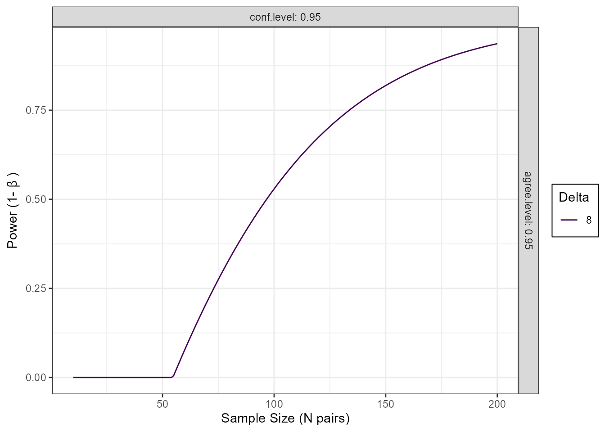

# Power Analysis and Sample Size Determination for Agreement Studies

## Introduction

This vignette provides comprehensive guidance on power analysis and
sample size determination for method comparison and agreement studies
using the `SimplyAgree` package.

### Available Methods

`SimplyAgree` implements four approaches to power/sample size
calculations for agreement (limits of agreement) studies:

1.  **[`power_agreement_exact()`](https://aaroncaldwell.us/SimplyAgree/reference/power_agreement_exact.md)** -
    Exact agreement test ([Shieh 2019](#ref-shieh2019))
2.  **[`blandPowerCurve()`](https://aaroncaldwell.us/SimplyAgree/reference/blandPowerCurve.md)** -
    Bland-Altman power curves ([Lu et al. 2016](#ref-lu2016))
3.  **[`agree_expected_half()`](https://aaroncaldwell.us/SimplyAgree/reference/agree_expected_half.md)** -
    Expected half-width criterion ([Jan and Shieh
    2018](#ref-JanShieh2018))
4.  **[`agree_assurance()`](https://aaroncaldwell.us/SimplyAgree/reference/agree_assurance.md)** -
    Assurance probability criterion ([Jan and Shieh
    2018](#ref-JanShieh2018))

and two for reliability studies that estimate an intraclass correlation
coefficient (ICC; see [Planning a Reliability
Study](#planning-a-reliability-study-icc)):

5.  **[`power_icc()`](https://aaroncaldwell.us/SimplyAgree/reference/power_icc.md)** -
    Power of the ICC test ([Walter et al. 1998](#ref-walter1998))
6.  **[`precision_icc()`](https://aaroncaldwell.us/SimplyAgree/reference/precision_icc.md)** -
    Width of the ICC confidence interval ([Zou 2012](#ref-zou2012);
    [Mondal et al. 2024](#ref-mondal2024))

``` r

library(SimplyAgree)
```

## Understanding the Approaches

### Hypothesis Testing vs. Estimation

The methods divide into two categories:

**Hypothesis Testing** (binary decision):

- [`power_agreement_exact()`](https://aaroncaldwell.us/SimplyAgree/reference/power_agreement_exact.md) -
  Tests if central proportion, essentially tolerance intevals, are
  within the maximal allowable difference
- [`blandPowerCurve()`](https://aaroncaldwell.us/SimplyAgree/reference/blandPowerCurve.md) -
  Tests if confidence intervals of limits of agreement fall within the
  maximal allowable difference

**Estimation** (quantifying precision):

- [`agree_expected_half()`](https://aaroncaldwell.us/SimplyAgree/reference/agree_expected_half.md) -
  Controls average CI half-width of limits of agreement
- [`agree_assurance()`](https://aaroncaldwell.us/SimplyAgree/reference/agree_assurance.md) -
  Controls probability of achieving target CI half-width of limits of
  agreement

## Method 1: Exact Agreement Test

### Overview

Tests whether the central P\* proportion of paired differences falls
within the maximal allowable difference \[-delta, delta\].

**Hypotheses:**

- H0: Methods disagree (central portion extends beyond bounds)
- H1: Methods agree (central portion within bounds)

### Usage

``` r

power_agreement_exact(
  n = NULL,           # Sample size
  delta = NULL,       # Tolerance bound
  mu = 0,            # Mean of differences
  sigma = NULL,       # SD of differences
  p0_star = 0.95,    # Central proportion (tolerance coverage)
  power = NULL,       # Target power
  alpha = 0.05       # Significance level
)
```

Specify **exactly three** of: n, delta, power, sigma.

### Example: Sample Size Calculation

``` r

# Blood pressure device comparison
result <- power_agreement_exact(
  delta = 7,          # +/-7 mmHg tolerance
  mu = 0.5,          # Expected bias
  sigma = 2.5,       # Expected SD
  p0_star = 0.95,    # 95% must be within bounds
  power = 0.80,      # 80% power
  alpha = 0.05
)
#> Maximum iterations reached in gamma computation
print(result)
#> 
#>      Power for Exact Method for Assessing Agreement Between Two Methods 
#> 
#>               n = 34
#>           delta = 7
#>              mu = 0.5
#>           sigma = 2.5
#>         p0_star = 0.95
#>         p1_star = 0.9939889
#>           alpha = 0.05
#>           power = 0.8018321
#>  critical_value = 13.57044
#> 
#> NOTE: H0: Central 95% of differences not within [-delta, delta]
#>      H1: Central 99.4% of differences within [-delta, delta] 
#> n is number pairs. Two measurements per unit; one for each method.
```

## Method 2: Bland-Altman Power Curves

### Overview

Calculates power curves using approximate Bland-Altman confidence
intervals using the method of Lu et al. ([2016](#ref-lu2016)) (which is
approximate). Useful for exploring power across sample sizes.

### Usage

``` r

blandPowerCurve(
  samplesizes = seq(10, 100, 1),  # Range of sample sizes
  mu = 0,                          # Mean difference
  SD,                              # SD of differences
  delta,                           # Tolerance bound(s)
  conf.level = 0.95,              # CI confidence level
  agree.level = 0.95               # LOA agreement level
)
```

### Example: Power Curve

``` r

# Generate power curve
pc <- blandPowerCurve(
  samplesizes = seq(10, 200, 1),
  mu = 0,
  SD = 3.3,
  delta = 8,
  conf.level = 0.95,
  agree.level = 0.95
)

# Plot
plot(pc, type = 1)
```



``` r


# Find n for 80% power
find_n(pc, power = 0.8)
#> # A tibble: 1 × 5
#>   delta conf.level agree.level power     N
#>   <dbl>      <dbl>       <dbl> <dbl> <dbl>
#> 1     8       0.95        0.95 0.800   145
```

## Method 3: Expected Half-Width

### Overview

Determines sample size to ensure **average** CI half-width \<= delta
across hypothetical repeated studies.

### Usage

``` r

agree_expected_half(
  conf.level = 0.95,    # CI confidence level
  delta = NULL,         # Target expected half-width
  pstar = 0.95,        # Central proportion
  sigma = 1,           # SD of differences
  n = NULL             # Sample size
)
```

Specify **either** n OR delta.

### Example: Sample Size for Precision

``` r

# Want E[H] <= 2.5*sigma
result <- agree_expected_half(
  conf.level = 0.95,
  delta = 2.5,         # As multiple of sigma
  pstar = 0.95,
  sigma = 1            # Standardized
)
print(result)
#> 
#>      Expected half-width and sample size for limits of agreement 
#> 
#>               n = 52
#>      conf.level = 0.95
#>    target.delta = 2.5
#>    actual.delta = 2.49677
#>           pstar = 0.95
#>           sigma = 1
#>               g = 2.509039
#>               c = 1.004914
#>              zp = 1.959964
```

## Method 4: Assurance Probability

### Overview

Determines sample size to ensure **probability** that CI half-width \<=
omega is at least (1-gamma).

Stronger guarantee than expected half-width — ensures specific
probability of achieving target precision.

### Usage

``` r

agree_assurance(
  conf.level = 0.95,     # CI confidence level
  assurance = 0.90,      # Target assurance probability
  omega = NULL,          # Target half-width bound
  pstar = 0.95,         # Central proportion
  sigma = 1,            # SD of differences
  n = NULL              # Sample size
)
```

Specify **either** n OR omega.

### Example: Sample Size with Guarantee

``` r

# Want 90% probability that H <= 2.5*sigma
result <- agree_assurance(
  conf.level = 0.95,
  assurance = 0.90,    # 90% probability
  omega = 2.5,         # Target bound
  pstar = 0.95,
  sigma = 1
)
print(result)
#> 
#>      Assurance probability & sample size for Limits of Agreement 
#> 
#>                n = 115
#>       conf.level = 0.95
#>        assurance = 0.9
#> actual.assurance = 0.9024848
#>            omega = 2.5
#>            pstar = 0.95
#>            sigma = 1
#>                g = 2.306167
#>               zp = 1.959964
```

## Decision Guide for the Method

    Research Goal?
    |
    |- Hypothesis Testing -> 
    |   \- Need exact Type I error control -> Power for Agreement
    |
    \- Precision Estimation ->
        |- Average precision sufficient -> Expected Half-Width
        \- Need probabilistic guarantee -> Assurance Probability

    Reliability (ICC) study?
    |
    |- Show the ICC exceeds a threshold -> power_icc()
    \- Estimate the ICC precisely -> precision_icc()

## Handling Clustered/Nested Data

### The Problem

Many studies have **clustered** data where there are multiple
measurements per subject or natural groupings (e.g., repeated measures,
multi-center studies). Note, the advice here only applies to clustering
but not to situations where replicate measures are taken within a
measurement occasion (e.g., multiple measures at the same time point
wherein any variation would only represent measurement error).

Standard formulas assume independence[^1]. Ignoring clustering can leads
to studies that lack precision. To my knowledge, there is no well
developed methods for accounting for clustering in sample size
calculations for agreement studies, so we use a common approximation
from survey sampling and multilevel modeling: the **design effect**.

### My Best Approximation: Design Effect

The design effect (DEFF) quantifies loss of efficiency due to
clustering:

\\\text{DEFF} = 1 + (m - 1) \times \text{ICC}\\

where:

- m = observations per cluster
- ICC = intraclass correlation coefficient
- \\n\_{ESS}\\ = effective sample size

**Effect on sample size:** \\n\_{\text{ESS}} = n\_{\text{independent}}
\times \text{DEFF}\\

### Understanding ICC

ICC = proportion of variance between clusters:

\\\text{ICC} =
\frac{\sigma^2\_{\text{between}}}{\sigma^2\_{\text{between}} +
\sigma^2\_{\text{within}}}\\

### Application Workflow

1.  Calculate independent sample size (using power function)
2.  Determine m (observations per cluster)
3.  Estimate ICC (from pilot data, literature, or theory)
4.  Calculate DEFF = 1 + (m-1)\*ICC
5.  Inflate: n_total = n_indep \* DEFF
6.  Calculate clusters: K = the smallest integer greater than or equal
    to (n_total / m) (i.e., round up n_total / m)

### Example: Repeated Measures Design

``` r

# Step 1: Independent sample size
result <- power_agreement_exact(
  delta = 7, mu = 0.5, sigma = 2.5,
  p0_star = 0.95, power = 0.80, alpha = 0.05
)
#> Maximum iterations reached in gamma computation
n_indep <- result$n
cat("Independent pairs needed:", n_indep, "\n")
#> Independent pairs needed: 34

# Step 2: Apply design effect
m <- 3  # 3 measurements per participant
ICC <- 0.15  # from pilot or literature
DEFF <- 1 + (m - 1) * ICC
cat("Design effect:", round(DEFF, 3), "\n")
#> Design effect: 1.3

# Step 3: Calculate participants needed
n_ess <- ceiling(n_indep * DEFF)
K <- ceiling(n_ess / m)
cat("Total observations:", n_ess, "\n")
#> Total observations: 45
cat("Participants needed:", K, "\n")
#> Participants needed: 15
```

**Result**: Instead of 34 independent pairs, need ~15 participants (45
total observations).

### Impact of ICC

``` r

# Compare different ICC values
n_indep <- 50
m <- 4

ICC_values <- c(0, 0.05, 0.10, 0.15, 0.20)
for (ICC in ICC_values) {
  DEFF <- 1 + (m - 1) * ICC
  K <- ceiling(ceiling(n_indep * DEFF) / m)
  cat(sprintf("ICC = %.2f: Need %d participants\n", ICC, K))
}
#> ICC = 0.00: Need 13 participants
#> ICC = 0.05: Need 15 participants
#> ICC = 0.10: Need 17 participants
#> ICC = 0.15: Need 19 participants
#> ICC = 0.20: Need 20 participants
```

### When Design Effect Works Well

**Good situations:**

- Balanced designs (equal cluster sizes)
- Moderate ICC (0.01 - 0.30)
- Sufficient clusters (K \>= 10)
- Simple two-level hierarchy

**Problematic:**

- Highly unbalanced clusters
- Very high ICC (\> 0.4)
- Small number of clusters (K \< 10)
- Complex correlation structures
- Multiple levels of nesting

For complex designs, consider simulation-based power analysis and
consult a statistician.

### Complete Example with Clustering

``` r

# Study parameters
sigma <- 3.3
delta <- 7
m <- 4  # measurements per participant
ICC <- 0.15
dropout <- 0.20

# Step 1: Independent sample size
result <- power_agreement_exact(
  delta = delta, mu = 0, sigma = sigma,
  p0_star = 0.95, power = 0.80, alpha = 0.05
)
#> Maximum iterations reached in gamma computation

# Step 2: Account for clustering
DEFF <- 1 + (m - 1) * ICC
n_total <- ceiling(result$n * DEFF)
K_pre <- ceiling(n_total / m)

# Step 3: Account for dropout
K_final <- ceiling(K_pre / (1 - dropout))

# Summary
cat("Independent pairs:", result$n, "\n")
#> Independent pairs: 566
cat("Design effect:", round(DEFF, 3), "\n")
#> Design effect: 1.45
cat("Participants (no dropout):", K_pre, "\n")
#> Participants (no dropout): 206
cat("Participants to recruit:", K_final, "\n")
#> Participants to recruit: 258
cat("Total measurements:", K_final * m, "\n")
#> Total measurements: 1032
```

## Planning a Reliability Study (ICC)

A reliability study asks whether a measurement ranks subjects
consistently, summarised by an intraclass correlation coefficient (ICC)
and analysed with
[`icc_test()`](https://aaroncaldwell.us/SimplyAgree/reference/icc_test.md)
(see the reliability analysis vignette). The same two goals apply as for
agreement:

- **Hypothesis testing:** show that the ICC is above a threshold
  (e.g. 0.6), with
  [`power_icc()`](https://aaroncaldwell.us/SimplyAgree/reference/power_icc.md).
- **Estimation:** make the confidence interval for the ICC narrow
  enough, with
  [`precision_icc()`](https://aaroncaldwell.us/SimplyAgree/reference/precision_icc.md).

Both work like
[`stats::power.t.test()`](https://rdrr.io/r/stats/power.t.test.html):
leave exactly one argument as `NULL` (by default the number of subjects,
`n`) and it is solved for. `k` is the number of measurements per subject
(trials, occasions or raters). `model` is `"oneway"` (the default) or
`"twoway"`, which is the consistency ICC, ICC(C,1), of
[`icc_test()`](https://aaroncaldwell.us/SimplyAgree/reference/icc_test.md).
With complete, normally distributed data, both calculations are exact:
the F ratio behind the ICC test and interval is a scaled central F
variable whatever the true ICC ([McGraw and Wong
1996](#ref-mcgraw1996)).

### Power for an ICC test

How many subjects are needed to show, with two trials and 80% power,
that the consistency ICC is above 0.6 when it is really 0.8?

``` r

power_icc(rho0 = 0.6, rho1 = 0.8, k = 2, power = 0.80,
          model = "twoway", alternative = "greater")
#> 
#>      Power calculation for the two-way consistency ICC, ICC(C,1) (exact F distribution) 
#> 
#>               n = 39.43736
#>               k = 2
#>            rho0 = 0.6
#>            rho1 = 0.8
#>       sig.level = 0.05
#>           power = 0.8
#>     alternative = greater
#> 
#> NOTE: n is the number of subjects; round up to a whole number.
#>       n = number of subjects, k = measurements per subject
```

Round up: 40 subjects. The same test would then be run with
`icc_test(..., null.value = 0.6, alternative = "greater")`.

Subjects can be traded for measurements. With only 20 subjects
available, solve for `k` instead:

``` r

power_icc(n = 20, k = NULL, rho0 = 0.6, rho1 = 0.8, power = 0.80,
          model = "twoway", alternative = "greater")
#> 
#>      Power calculation for the two-way consistency ICC, ICC(C,1) (exact F distribution) 
#> 
#>               n = 20
#>               k = 5
#>            rho0 = 0.6
#>            rho1 = 0.8
#>       sig.level = 0.05
#>           power = 0.8
#>     alternative = greater
#> 
#> NOTE: n = number of subjects, k = measurements per subject
```

Five trials per subject would be needed.

A power curve over a range of sample sizes is a useful sensitivity
analysis, here for an ICC of 0.75 or 0.8 under the alternative:

``` r

n_seq <- seq(10, 80, by = 5)
pw <- sapply(c(0.75, 0.80), function(r1) {
  sapply(n_seq, function(n) {
    power_icc(n = n, k = 2, rho0 = 0.6, rho1 = r1, model = "twoway",
              alternative = "greater")$power
  })
})
matplot(n_seq, pw, type = "l", lty = 1:2, col = 1, ylim = c(0, 1),
        xlab = "Number of subjects", ylab = "Power")
abline(h = 0.8, col = "grey")
legend("bottomright", legend = c("ICC = 0.75", "ICC = 0.80"), lty = 1:2)
```


### Precision of an ICC

When the goal is to estimate the ICC rather than to test it, plan for
the width of its 95% confidence interval (upper minus lower limit).
Because the width varies from sample to sample, `assurance` sets the
probability that the interval is no wider than planned; the default,
0.5, plans for the median width.

``` r

# Median width of 0.2 around an ICC of 0.8, with three trials
precision_icc(rho = 0.8, k = 3, width = 0.2, model = "twoway")
#> 
#>      Precision (confidence interval width) calculation for the two-way consistency ICC, ICC(C,1) (exact F distribution) 
#> 
#>               n = 36.74614
#>               k = 3
#>             rho = 0.8
#>           width = 0.2
#>      conf.level = 0.95
#>       assurance = 0.5
#> 
#> NOTE: n is the number of subjects; round up to a whole number.
#>       n = number of subjects, k = measurements per subject; width = upper minus lower limit

# The same width with 80% assurance
precision_icc(rho = 0.8, k = 3, width = 0.2, assurance = 0.8,
              model = "twoway")
#> 
#>      Precision (confidence interval width) calculation for the two-way consistency ICC, ICC(C,1) (exact F distribution) 
#> 
#>               n = 48.68426
#>               k = 3
#>             rho = 0.8
#>           width = 0.2
#>      conf.level = 0.95
#>       assurance = 0.8
#> 
#> NOTE: n is the number of subjects; round up to a whole number.
#>       n = number of subjects, k = measurements per subject; width = upper minus lower limit
```

Planning for the median width needs 37 subjects; a guarantee that the
interval will be that narrow 80% of the time needs 49. For a one-sided
goal (a lower confidence limit above some value), use
[`power_icc()`](https://aaroncaldwell.us/SimplyAgree/reference/power_icc.md)
with `alternative = "greater"`: the probability that the lower limit
exceeds `rho0` is the power of the one-sided test.

### Average measures

If the measurement used in practice will be the mean of the `k` trials,
plan for the average-measure ICC, ICC(k) or ICC(C,k), with
`unit = "average"`. The ICC values and the width are then on the
average-measure scale, and the calculations remain exact (the
average-measure ICC is the Spearman-Brown projection of the
single-measure ICC):

``` r

precision_icc(rho = 0.9, k = 3, width = 0.1, assurance = 0.8,
              model = "twoway", unit = "average")
#> 
#>      Precision (confidence interval width) calculation for the two-way consistency average-measure ICC, ICC(C,k) (exact F distribution) 
#> 
#>               n = 70.17474
#>               k = 3
#>             rho = 0.9
#>           width = 0.1
#>      conf.level = 0.95
#>       assurance = 0.8
#> 
#> NOTE: n is the number of subjects; round up to a whole number.
#>       n = number of subjects, k = measurements per subject; width = upper minus lower limit
```

### Missing measurements and dropout

If some measurements will be missing here and there (a missed trial, a
rater who skipped a subject), give the expected proportion of missing
subject-by-item cells in `missing`. The calculation then follows the
REML analysis of `icc_test(method = "reml")`, using the observed-data
degrees of freedom. This is an approximation, but in simulations with up
to 30% missing the approximate power was within 0.035 of the simulated
power.

``` r

power_icc(rho0 = 0.6, rho1 = 0.8, k = 2, power = 0.80, model = "twoway",
          alternative = "greater", missing = 0.15)
#> 
#>      Power calculation for the two-way consistency ICC, ICC(C,1) (F distribution with observed-data df; approximate) 
#> 
#>               n = 51.49918
#>               k = 2
#>            rho0 = 0.6
#>            rho1 = 0.8
#>       sig.level = 0.05
#>           power = 0.8
#>     alternative = greater
#>         missing = 0.15
#> 
#> NOTE: n is the number of subjects; round up to a whole number.
#>       approximate: 15% of measurements missing at random, analysed with icc_test(method = "reml")
#>       n = number of subjects, k = measurements per subject
```

With 15% of measurements missing, 52 subjects are needed instead of 40.

Subjects lost entirely are different: plan for the subjects who complete
the study and recruit n / (1 - d) for an expected dropout d.

### Other designs

The exact calculations cover the one-way and two-way consistency ICCs.
They can still guide other designs, as long as the direction of the
error is known:

- **Absolute agreement ICC, ICC(A,1), and the CCC.** These have no exact
  F distribution. When the trials or raters differ little
  systematically, ICC(A,1) is close to ICC(C,1) and the consistency
  calculation is a good guide. When they differ, power is lower and
  intervals are wider, most of all with 2 or 3 items. Treat the
  consistency result as a **lower bound** on the number of subjects.
- **Non-normal data.** With skewed or heavy-tailed data the F-based
  intervals are wider and cover less than planned. Allow a margin, or
  plan for a bootstrap analysis with a larger sample.
- **Published tables.** `method = "approximate"` reproduces the closed
  forms of Walter et al. ([1998](#ref-walter1998)) (power) and Zou
  ([2012](#ref-zou2012)) (precision), for the one-way ICC only. The
  exact method is preferred ([Mondal et al. 2024](#ref-mondal2024)).

``` r

power_icc(rho0 = 0.6, rho1 = 0.8, k = 2, power = 0.80,
          alternative = "greater", method = "approximate")
#> 
#>      Power calculation for the one-way ICC, ICC(1) (approximate closed form) 
#> 
#>               n = 38.60635
#>               k = 2
#>            rho0 = 0.6
#>            rho1 = 0.8
#>       sig.level = 0.05
#>           power = 0.8
#>     alternative = greater
#> 
#> NOTE: n is the number of subjects; round up to a whole number.
#>       n = number of subjects, k = measurements per subject
```

## Practical Recommendations

### Planning Checklist

Define research question (hypothesis test vs. estimation)

Choose appropriate power method

If possible, obtain pilot estimates (SD, ICC if clustered)

Calculate independent sample size

Adjust for clustering (if applicable)

Adjust for dropout

Conduct sensitivity analyses

Document all assumptions and sources

Pre-register before data collection

### Conservative Planning

When uncertain:

- Use **upper range** of plausible SD estimates
- Use **upper range** of plausible ICC estimates
- Build in **10-20% buffer** beyond calculated required sample size
- Conduct **sensitivity analyses** for key parameters (SD, ICC, etc)

## References

Bland, J. Martin. 2003. *Cluster Randomised Trials in the Medical
Literature: Two Bibliometric Surveys*. Talk presented to the RSS Medical
Section and RSS Liverpool Local Group.
<https://www-users.york.ac.uk/~mb55/talks/clusml.htm>.

Jan, Show-Li, and Gwowen Shieh. 2018. “The Bland-Altman Range of
Agreement: Exact Interval Procedure and Sample Size Determination.”
*Comput. Biol. Med.* 100 (September): 247–52.

Lu, Meng-Jie, Wei-Hua Zhong, Yu-Xiu Liu, Hua-Zhang Miao, Yong-Chang Li,
and Mu-Huo Ji. 2016. “Sample Size for Assessing Agreement Between Two
Methods of Measurement by Bland-Altman Method.” *The International
Journal of Biostatistics* 12 (2).
<https://doi.org/10.1515/ijb-2015-0039>.

McGraw, Kenneth O, and Seok P Wong. 1996. “Forming Inferences about Some
Intraclass Correlation Coefficients.” *Psychological Methods* 1 (1): 30.
<https://doi.org/10.1037/1082-989X.1.1.30>.

Mondal, Dipro, Sophie Vanbelle, Alberto Cassese, and Math J. J. M.
Candel. 2024. “Review of Sample Size Determination Methods for the
Intraclass Correlation Coefficient in the One-Way Analysis of Variance
Model.” *Statistical Methods in Medical Research* 33 (3): 532–53.
<https://doi.org/10.1177/09622802231224657>.

Shieh, Gwowen. 2019. “Assessing Agreement Between Two Methods of
Quantitative Measurements: Exact Test Procedure and Sample Size
Calculation.” *Statistics in Biopharmaceutical Research* 12 (3): 352–59.
<https://doi.org/10.1080/19466315.2019.1677495>.

Walter, S. D., M. Eliasziw, and A. Donner. 1998. “Sample Size and
Optimal Designs for Reliability Studies.” *Statistics in Medicine* 17
(1): 101–10.
<https://doi.org/10.1002/(SICI)1097-0258(19980115)17:1%3C101::AID-SIM727%3E3.0.CO;2-E>.

Zou, G. Y. 2012. “Sample Size Formulas for Estimating Intraclass
Correlation Coefficients with Precision and Assurance.” *Statistics in
Medicine* 31 (29): 3972–81. <https://doi.org/10.1002/sim.5466>.

[^1]: Implications of which are discussed by Bland
    ([2003](#ref-bland2003cluster)) among many others
