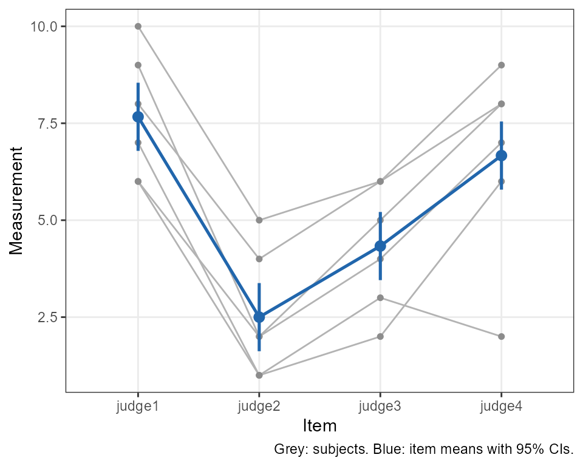
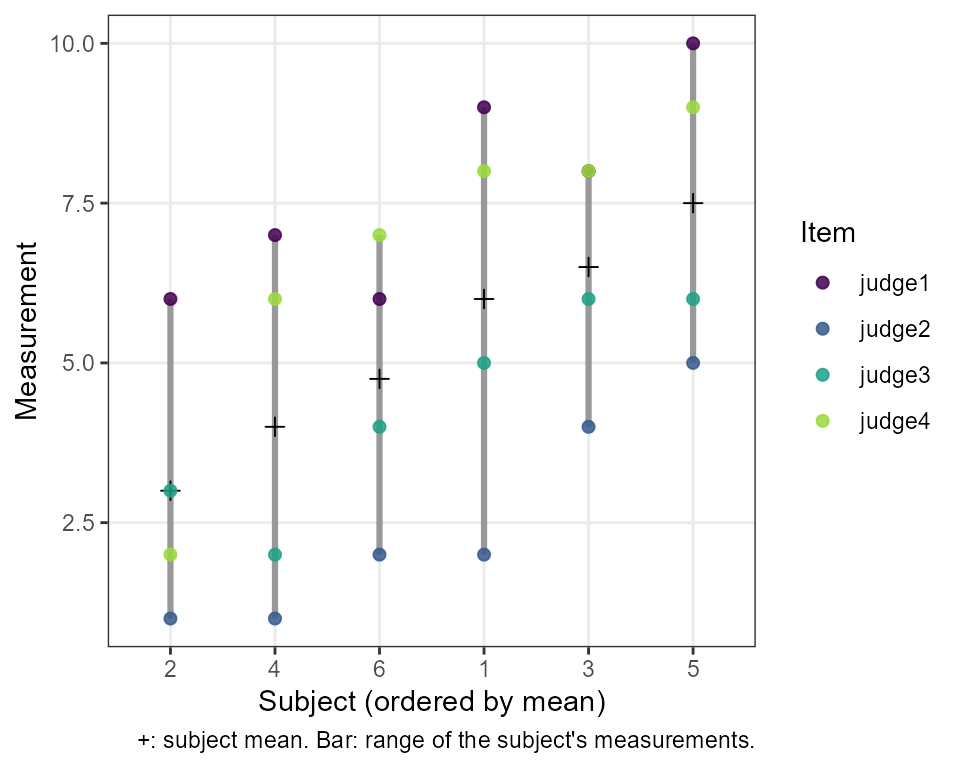
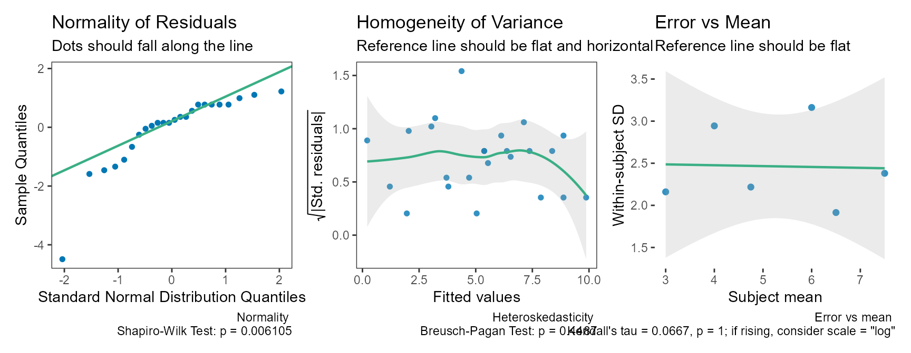

# Reliability Analysis

## Background

Reliability studies ask two related questions. *Relative* reliability
asks whether a measurement ranks subjects consistently; it is summarised
by an intraclass correlation coefficient (ICC), the proportion of the
observed variance that is due to real differences between subjects.
*Absolute* reliability asks how much a single measurement varies around
a subject’s true value; it is summarised by the standard error of
measurement (SEM), also called the typical error ([Hopkins
2000](#ref-hopkins2000)), often expressed as a coefficient of variation.
The calculations here follow Weir ([2005](#ref-weir2005)), who in turn
relies on Shrout and Fleiss ([1979](#ref-shrout1979)) and McGraw and
Wong ([1996](#ref-mcgraw1996)).

`SimplyAgree` has one function for each question, each returning a
standard `htest` object with a confidence interval and, optionally, a
test:

| Function | Estimates |
|----|----|
| [`icc_test()`](https://aaroncaldwell.us/SimplyAgree/reference/icc_test.md) | One ICC |
| [`reli_err_test()`](https://aaroncaldwell.us/SimplyAgree/reference/reli_err_test.md) | The SEM, SEE or SEP, in units, sympercents or % of the mean |
| [`power_icc()`](https://aaroncaldwell.us/SimplyAgree/reference/power_icc.md), [`precision_icc()`](https://aaroncaldwell.us/SimplyAgree/reference/precision_icc.md) | Sample size for an ICC study |

The older
[`reli_stats()`](https://aaroncaldwell.us/SimplyAgree/reference/reli_stats.md)
and
[`reli_aov()`](https://aaroncaldwell.us/SimplyAgree/reference/reli_stats.md),
which return everything at once, are superseded (see [Legacy
functions](#legacy-functions)).

All functions accept data in three ways: a formula,
`values ~ item | id`; long data, with `measure`, `item` and `id` column
names; or wide data, one row per subject, with the item columns in
`col.names`. An *item* is whatever is repeated: a trial, an occasion, a
rater, or a judge.

As an example, take the data of Shrout and Fleiss
([1979](#ref-shrout1979)) (6 subjects rated by 4 judges).

``` r

dat <- data.frame(judge1 = c(9, 6, 8, 7, 10, 6),
                  judge2 = c(2, 1, 4, 1, 5, 2),
                  judge3 = c(5, 3, 6, 2, 6, 4),
                  judge4 = c(8, 2, 8, 6, 9, 7))
judges <- c("judge1", "judge2", "judge3", "judge4")
```

## The intraclass correlation coefficient

``` r

icc_test(col.names = judges, data = dat)
#> 
#>  Two-way, consistency, single-measure ICC [Shrout & Fleiss ICC(3,1)]
#> 
#> data:  judge1, judge2, judge3, judge4
#> 
#> alternative hypothesis: two.sided
#> 95 percent confidence interval:
#>  0.3424648 0.9458583
#> sample estimates:
#>  ICC(C,1) 
#> 0.7148407
```

### Choosing the ICC

The form is set by three arguments. `model` says whether every subject
is measured on the same items (`"twoway"`) or each subject by different
items (`"oneway"`); `type` says whether systematic differences between
items count as error (`"agreement"`) or not (`"consistency"`); and
`unit` says whether the reliability of a single measurement (`"single"`)
or of the mean of all k items (`"average"`) is wanted.

| `model` | `type`      | `unit`  | McGraw & Wong | Shrout & Fleiss |
|---------|-------------|---------|---------------|-----------------|
| oneway  | agreement   | single  | ICC(1)        | ICC(1,1)        |
| oneway  | agreement   | average | ICC(k)        | ICC(1,k)        |
| twoway  | agreement   | single  | ICC(A,1)      | ICC(2,1)        |
| twoway  | agreement   | average | ICC(A,k)      | ICC(2,k)        |
| twoway  | consistency | single  | ICC(C,1)      | ICC(3,1)        |
| twoway  | consistency | average | ICC(C,k)      | ICC(3,k)        |

The default, ICC(C,1), follows Hopkins ([2000](#ref-hopkins2000)) and
Weir ([2005](#ref-weir2005)): check for systematic change between trials
separately (for example with
[`t.test()`](https://rdrr.io/r/stats/t.test.html) for two trials), then
report the consistency ICC, which is tied to the SEM. Others, such as
Koo and Li ([2016](#ref-koo2016)), recommend absolute agreement for
test-retest studies:

``` r

icc_test(col.names = judges, data = dat, type = "agreement")
#> 
#>  Two-way, absolute agreement, single-measure ICC [Shrout & Fleiss
#>  ICC(2,1)]
#> 
#> data:  judge1, judge2, judge3, judge4
#> 
#> alternative hypothesis: two.sided
#> 95 percent confidence interval:
#>  0.01878651 0.76108437
#> sample estimates:
#>  ICC(A,1) 
#> 0.2897638
```

### Testing against a threshold

By default no test is done: testing whether an ICC differs from 0 is
rarely informative. No qualitative labels (“good”, “excellent”) are
given either, because published cutoffs disagree and the ICC depends on
how much subjects differ from each other ([Weir 2005](#ref-weir2005)).
To claim that reliability exceeds a value, test against it:

``` r

res <- icc_test(col.names = judges, data = dat,
                null.value = 0.5, alternative = "greater")
res
#> 
#>  Two-way, consistency, single-measure ICC [Shrout & Fleiss ICC(3,1)]
#> 
#> data:  judge1, judge2, judge3, judge4
#> F = 2.2054, df1 = 5, df2 = 15, p-value = 0.108
#> alternative hypothesis: true ICC is greater than 0.5
#> 95 percent confidence interval:
#>  0.4118341 1.0000000
#> sample estimates:
#>  ICC(C,1) 
#> 0.7148407
```

With a one-sided alternative the interval is one-sided too: its lower
limit is the one-sided bound that matches the test.

### Describing the result

[`summary()`](https://rdrr.io/r/base/summary.html) describes the result
in words, in one of two styles. With a test, the default is the usual
decision about the null hypothesis:

``` r

summary(res)
#> The test is not statistically significant (F(5, 15) = 2.21, p = 0.108;
#> ICC(C,1) = 0.715, 95% lower bound 0.412) at the 0.05 alpha level. The
#> null hypothesis cannot be rejected: at the desired error rate, it
#> cannot be stated that the true ICC is greater than 0.5. The estimate is
#> the two-way, consistency, single-measure ICC (McGraw & Wong ICC(C,1);
#> Shrout & Fleiss ICC(3,1)): the reliability of a single measurement,
#> excluding systematic differences between items. The data had 6 subjects
#> and 4 items (24 measurements, none missing); variance components were
#> estimated by analysis of variance. The interval and F test are exact
#> (McGraw & Wong, 1996).
```

The estimation style, following Greenland ([2019](#ref-greenland2019))
and Rafi and Greenland ([2020](#ref-rafi2020)), describes the interval
as a range of values compatible with the data and converts the p-value
to an S-value, \\s = -\log_2 p\\: the bits of information against the
tested hypothesis, as surprising as \\s\\ heads in a row from a fair
coin.

``` r

summary(res, style = "estimation")
#> The estimated ICC(C,1) was 0.715 (95% lower compatibility bound 0.412).
#> Values above this bound are the most compatible with the data, given
#> the model and its assumptions. Against the hypothesis that the true
#> ICC(C,1) is at most 0.5, p = 0.108, an S-value of 3.21 bits of
#> information (S = -log2 p): about as surprising as getting 3 heads in a
#> row from 3 tosses of a fair coin. The estimate is the two-way,
#> consistency, single-measure ICC (McGraw & Wong ICC(C,1); Shrout &
#> Fleiss ICC(3,1)): the reliability of a single measurement, excluding
#> systematic differences between items. The data had 6 subjects and 4
#> items (24 measurements, none missing); variance components were
#> estimated by analysis of variance. The interval and F test are exact
#> (McGraw & Wong, 1996).
```

### Missing data and the bootstrap

`method = "anova"` (the default) needs every subject measured on every
item. With missing measurements, `method = "reml"` fits a linear mixed
model; its intervals use degrees of freedom based on the observed data
and are approximate, so a warning is given.

``` r

dat_na <- dat
dat_na$judge2[1] <- NA
icc_test(col.names = judges, data = dat_na, method = "reml")
#> Warning: 4.2% of subject-by-item cells are missing. Intervals and p-values use
#> observed-data degrees of freedom and are approximate; they may be liberal as
#> missingness increases. Consider boot = TRUE.
#> 
#>  Two-way, consistency, single-measure ICC [Shrout & Fleiss ICC(3,1)]
#>  (REML)
#> 
#> data:  judge1, judge2, judge3, judge4
#> 
#> alternative hypothesis: two.sided
#> 95 percent confidence interval:
#>  0.3861657 0.9541005
#> sample estimates:
#>  ICC(C,1) 
#> 0.7499675
```

With clearly non-normal data, `boot = TRUE` gives a bootstrap interval
that resamples subjects. The interval type (`boot_ci`) and the standard
error used to studentize it (`se_method`) were chosen from simulations
described in
[`?icc_test`](https://aaroncaldwell.us/SimplyAgree/reference/icc_test.md).

``` r

set.seed(2026)
icc_test(col.names = judges, data = dat, boot = TRUE, replicates = 999)
#> 
#>  Two-way, consistency, single-measure ICC [Shrout & Fleiss ICC(3,1)]
#>  with nonparametric (subject) bootstrap studentized interval
#> 
#> data:  judge1, judge2, judge3, judge4
#> 
#> alternative hypothesis: two.sided
#> 95 percent confidence interval:
#>  0.3739154 0.8993188
#> sample estimates:
#>  ICC(C,1) 
#> 0.7148407
```

### Plots and diagnostics

[`plot()`](https://rdrr.io/r/graphics/plot.default.html) shows each
subject’s measurements across the items (grey), with the item means and
their 95% confidence intervals (blue), so systematic differences between
items stand out against the spread of subjects.

``` r

res <- icc_test(col.names = judges, data = dat)
plot(res)
```



Other views are chosen with `type`: `"subjects"` orders the subjects by
their mean and shows each subject’s measurements, which compares the
spread between subjects with the scatter within subjects (what the ICC
summarises); `"items"` shows each measurement’s deviation from its
subject’s mean by item (systematic item differences, which count as
error for an agreement ICC but not for a consistency ICC); and `"pairs"`
plots each pair of items against each other with the line of identity.

``` r

plot(res, type = "subjects")
```



[`check()`](https://aaroncaldwell.us/SimplyAgree/reference/simple_agree-methods.md)
gives model diagnostics: the normality and homogeneity of the residuals,
and the within-subject SD against the subject mean. An SD that rises
with the mean means the error grows with the size of the measurement,
and a coefficient of variation (`reli_err_test(scale = "log")`, below)
describes it better than an error in units.

``` r

check(res)
```



## Measurement error

[`reli_err_test()`](https://aaroncaldwell.us/SimplyAgree/reference/reli_err_test.md)
estimates the standard error of measurement (SEM), estimate (SEE) or
prediction (SEP). With the defaults it gives the typical error:
\\\sqrt{MS_E}\\ from the two-way analysis of variance, which excludes
systematic differences between trials. As an example, take data set A of
Weir ([2005](#ref-weir2005)) (8 subjects, 2 trials).

``` r

weir <- data.frame(t1 = c(146, 148, 170, 90, 157, 156, 176, 205),
                   t2 = c(140, 152, 152, 99, 145, 153, 167, 218))
reli_err_test(col.names = c("t1", "t2"), data = weir)
#> 
#>  Standard error of measurement (two-way, consistency)
#> 
#> data:  t1, t2
#> 
#> alternative hypothesis: two.sided
#> 95 percent confidence interval:
#>   4.996445 15.380402
#> sample estimates:
#>      SEM 
#> 7.556927
```

To show that the error is smaller than an acceptable value, give it as
`null.value` (the default alternative is `"less"`):

``` r

reli_err_test(col.names = c("t1", "t2"), data = weir, null.value = 12)
#> 
#>  Standard error of measurement (two-way, consistency)
#> 
#> data:  t1, t2
#> X-squared = 2.776, df = 7, p-value = 0.09508
#> alternative hypothesis: true SEM is less than 12
#> 95 percent confidence interval:
#>   0.00000 13.58094
#> sample estimates:
#>      SEM 
#> 7.556927
```

The SEE is the standard error of a subject’s estimated true score, and
the SEP is used to judge whether a change from the estimated true score
is real ([Weir 2005](#ref-weir2005)). Both depend on the ICC and on how
much subjects differ, so the SEM is the better general description of
measurement error.

``` r

reli_err_test(col.names = c("t1", "t2"), data = weir, stat = "SEP")
#> 
#>  Standard error of prediction (two-way, consistency) from ICC(C,1)
#> 
#> data:  t1, t2
#> 
#> alternative hypothesis: two.sided
#> 95 percent confidence interval:
#>   6.331135 17.562180
#> sample estimates:
#>     SEP 
#> 10.5446
```

The SEE and SEP use the SD matched to the ICC’s denominator (for the
consistency ICC, \\SD^2 = \sigma^2\_{subjects} + \sigma^2\_{error}\\),
so that \\SD\sqrt{1 - ICC}\\ equals the SEM exactly. Weir
([2005](#ref-weir2005)) uses the SD of all the measurements instead, so
his SEE and SEP (7.1 and 10.2 here) are slightly smaller than these
(7.35 and 10.54).

## Coefficient of variation

When the error grows with the size of the measurements, it is better
expressed relative to them ([Atkinson and Nevill
1998](#ref-atkinson1998); [Hopkins 2000](#ref-hopkins2000)).
[`reli_err_test()`](https://aaroncaldwell.us/SimplyAgree/reference/reli_err_test.md)
gives the coefficient of variation in two ways.

`scale = "log"` analyses the log-transformed measurements and reports
100 times the statistic, in sympercents ([Cole 2000](#ref-cole2000)).
The SEM keeps its exact interval.

``` r

reli_err_test(col.names = c("t1", "t2"), data = weir, scale = "log")
#> 
#>  Standard error of measurement (two-way, consistency), log scale
#>  (sympercents)
#> 
#> data:  t1, t2
#> 
#> alternative hypothesis: two.sided
#> 95 percent confidence interval:
#>   3.327576 10.243176
#> sample estimates:
#> SEM (sympercent) 
#>         5.032829
```

A sympercent \\s\\ converts to the conventional CV% as
\\100\sqrt{\exp((s/100)^2) - 1}\\; below about 15% the two are nearly
identical (10 sympercents is a CV of 10.03%). The conversion is
monotone, so it can be applied to the interval limits too.

`scale = "mean"` divides the statistic by the grand mean (the “pooled”
CV); its interval allows for the uncertainty in the mean.

``` r

reli_err_test(col.names = c("t1", "t2"), data = weir, scale = "mean")
#> 
#>  Standard error of measurement (two-way, consistency), as a percentage
#>  of the grand mean
#> 
#> data:  t1, t2
#> 
#> alternative hypothesis: two.sided
#> 95 percent confidence interval:
#>  2.731810 8.743404
#> sample estimates:
#> SEM (% of mean) 
#>        4.887261
```

In both cases `null.value` is on the same scale as the estimate.

## MDC, SDD and the repeatability coefficient

The minimal detectable change (MDC), smallest detectable or real
difference (SDD, SRD), “minimal difference” ([Weir 2005](#ref-weir2005))
and repeatability coefficient are all the SEM scaled by \\z \sqrt{2}\\:
for 95%, \\1.96 \sqrt{2} \times SEM\\, the change between two
measurements that measurement error alone would exceed only 5% of the
time. Scale the estimate and interval of
[`reli_err_test()`](https://aaroncaldwell.us/SimplyAgree/reference/reli_err_test.md):

``` r

sem <- reli_err_test(col.names = c("t1", "t2"), data = weir)
qnorm(0.975) * sqrt(2) * c(sem$estimate, sem$conf.int)
#>      SEM                   
#> 20.94635 13.84918 42.63152
```

With two trials this is the half-width of the limits of agreement of
[`agreement_limit()`](https://aaroncaldwell.us/SimplyAgree/reference/agreement_limit.md),
which also reports the bias between trials. Weir ([2005](#ref-weir2005))
notes that, strictly, real change should be judged against an interval
around the subject’s estimated true score, using the SEP.

## Planning a reliability study

[`power_icc()`](https://aaroncaldwell.us/SimplyAgree/reference/power_icc.md)
gives the power of the ICC test, or the number of subjects (`n`),
measurements per subject (`k`), or the ICC under the alternative needed
for a given power. For example, the subjects needed to show, with two
trials and 80% power, that the ICC is above 0.6 when it is really 0.8:

``` r

power_icc(rho0 = 0.6, rho1 = 0.8, k = 2, power = 0.8,
          alternative = "greater")
#> 
#>      Power calculation for the one-way ICC, ICC(1) (exact F distribution) 
#> 
#>               n = 38.90078
#>               k = 2
#>            rho0 = 0.6
#>            rho1 = 0.8
#>       sig.level = 0.05
#>           power = 0.8
#>     alternative = greater
#> 
#> NOTE: n is the number of subjects; round up to a whole number.
#>       n = number of subjects, k = measurements per subject
```

[`precision_icc()`](https://aaroncaldwell.us/SimplyAgree/reference/precision_icc.md)
instead plans for a narrow confidence interval: here, the subjects
needed for a 95% interval no wider than 0.2 around an ICC of 0.8, with
three trials, with 80% assurance (the probability that the interval is
that narrow).

``` r

precision_icc(rho = 0.8, k = 3, width = 0.2, assurance = 0.8)
#> 
#>      Precision (confidence interval width) calculation for the one-way ICC, ICC(1) (exact F distribution) 
#> 
#>               n = 48.34247
#>               k = 3
#>             rho = 0.8
#>           width = 0.2
#>      conf.level = 0.95
#>       assurance = 0.8
#> 
#> NOTE: n is the number of subjects; round up to a whole number.
#>       n = number of subjects, k = measurements per subject; width = upper minus lower limit
```

Both are exact for the one-way and consistency ICCs;
`method = "approximate"` reproduces the published formulas of Walter et
al. ([1998](#ref-walter1998)) and Zou ([2012](#ref-zou2012)) (see also
Mondal et al. ([2024](#ref-mondal2024))). The agreement ICC has no exact
distribution and is not supported.

## Legacy functions

[`reli_stats()`](https://aaroncaldwell.us/SimplyAgree/reference/reli_stats.md)
(linear mixed model) and
[`reli_aov()`](https://aaroncaldwell.us/SimplyAgree/reference/reli_stats.md)
(analysis of variance) return all six ICCs, the CV, SEM, SEE and SEP at
once. They are superseded but still work.

``` r

reli_aov(data = dat, wide = TRUE, col.names = judges)
#> 
#> Coefficient of Variation (%):  19.1
#> Standard Error of Measurement (SEM):  1.01
#> Standard Error of the Estimate (SEE):  1.22
#> Standard Error of Prediction (SEP):  1.9
#> 
#> Intraclass Correlation Coefficients with  95 % C.I.
#>            Model         Measures  Type    ICC Lower CI Upper CI
#> 1 one-way random        Agreement  ICC1 0.1657 -0.13293   0.7226
#> 2 two-way random        Agreement  ICC2 0.2898  0.01879   0.7611
#> 3  two-way fixed      Consistency  ICC3 0.7148  0.34246   0.9459
#> 4 one-way random   Avg. Agreement ICC1k 0.4428 -0.88444   0.9124
#> 5 two-way random   Avg. Agreement ICC2k 0.6201  0.07114   0.9272
#> 6  two-way fixed Avg. Consistency ICC3k 0.9093  0.67567   0.9859
```

Since version 0.3.1 they use the same engine as
[`icc_test()`](https://aaroncaldwell.us/SimplyAgree/reference/icc_test.md).
In particular, their ICC intervals are now two-sided. Previous versions
used `conf.level` in each tail, so a “95%” interval was really a 90%
interval; the old numbers at `conf.level = c` are reproduced with
`conf.level = 1 - 2 * (1 - c)`. Their SEE and SEP keep the SD of all the
measurements, as in Weir ([2005](#ref-weir2005)). See
[`?reli_stats`](https://aaroncaldwell.us/SimplyAgree/reference/reli_stats.md)
for the other changes.

## Calculative approach

### Model and mean squares

For n subjects each measured on k items, the two-way model is \\y\_{ij}
= \mu + s_i + t_j + e\_{ij}\\, with subject effects \\s_i\\ (variance
\\\sigma^2_s\\), item effects \\t_j\\ (\\\sigma^2_t\\) and error
\\e\_{ij}\\ (\\\sigma^2_e\\). The analysis of variance gives the mean
squares for subjects (\\MS_B\\, \\n - 1\\ df), items (\\MS_J\\, \\k -
1\\ df) and error (\\MS_E\\, \\(n-1)(k-1)\\ df), and the within-subject
mean square \\MS_W = (MS_J + (n-1) MS_E)/n\\ (\\n(k-1)\\ df). Their
expectations are

\\ E(MS_B) = k\sigma^2_s + \sigma^2_e, \quad E(MS_J) = n\sigma^2_t +
\sigma^2_e, \quad E(MS_E) = \sigma^2_e. \\

With `method = "reml"`, the variance components come from a linear mixed
model and the mean squares are reconstructed from them.

### Intraclass correlation coefficients

\\ ICC(1) = \frac{MS_B - MS_W}{MS_B + (k-1) MS_W} \\

\\ ICC(A,1) = \frac{MS_B - MS_E}{MS_B + (k-1) MS_E + k (MS_J - MS_E)/n}
\\

\\ ICC(C,1) = \frac{MS_B - MS_E}{MS_B + (k-1) MS_E} \\

The average-measure forms are the Spearman-Brown projection of the
single-measure form to k items, \\k\rho / (1 + (k-1)\rho)\\; for example
\\ICC(C,k) = (MS_B - MS_E)/MS_B\\ and \\ICC(A,k) = (MS_B - MS_E)/(MS_B +
(MS_J - MS_E)/n)\\.

### Confidence intervals and tests

A two-sided \\1 - \alpha\\ interval uses \\\alpha/2\\ in each tail
([Shrout and Fleiss 1979](#ref-shrout1979); [McGraw and Wong
1996](#ref-mcgraw1996)). For ICC(1) and ICC(C,1), with \\F = MS_B/MS_W\\
or \\MS_B/MS_E\\ and its degrees of freedom \\(\nu_1, \nu_2)\\,

\\ F_L = \frac{F}{F\_{1-\alpha/2;\\ \nu_1, \nu_2}}, \quad F_U = F \cdot
F\_{1-\alpha/2;\\ \nu_2, \nu_1}, \quad \text{limits} = \frac{F\_{L,U} -
1}{F\_{L,U} + k - 1}. \\

These intervals are exact. For ICC(A,1) the denominator degrees of
freedom are approximated ([Satterthwaite 1946](#ref-satterthwaite1946);
[McGraw and Wong 1996](#ref-mcgraw1996)),

\\ v = \frac{(a MS_J + b MS_E)^2}{\frac{(a MS_J)^2}{k-1} + \frac{(b
MS_E)^2}{(n-1)(k-1)}}, \quad a = \frac{k \hat\rho}{n(1-\hat\rho)}, \quad
b = 1 + \frac{k\hat\rho (n-1)}{n(1-\hat\rho)}, \\

and with \\F^\*\_{L} = F\_{1-\alpha/2;\\ n-1, v}\\ and \\F^\*\_{U} =
F\_{1-\alpha/2;\\ v, n-1}\\,

\\ L = \frac{n(MS_B - F^\*\_L MS_E)}{F^\*\_L (k MS_J + (kn - k - n)
MS_E) + n MS_B}, \quad U = \frac{n(F^\*\_U MS_B - MS_E)}{k MS_J + (kn -
k - n) MS_E + n F^\*\_U MS_B}. \\

The tests of \\H_0: \rho = \rho_0\\ are the F tests of McGraw and Wong
([1996](#ref-mcgraw1996)): for ICC(C,1), \\F =
(MS_B/MS_E)(1-\rho_0)/(1 + (k-1)\rho_0)\\ on \\(n-1, (n-1)(k-1))\\
degrees of freedom, and similarly for the other forms.

### Standard errors of measurement

| Statistic | Estimate | Interval |
|----|----|----|
| SEM, two-way consistency | \\\sqrt{MS_E}\\ | exact \\\chi^2\\ |
| SEM, two-way agreement | \\\sqrt{(MS_J + (n-1)MS_E)/n}\\ | Satterthwaite \\\chi^2\\ |
| SEM, one-way | \\\sqrt{MS_W}\\ | exact \\\chi^2\\ |
| SEE | \\SD\sqrt{ICC(1-ICC)}\\ | delta method, log scale |
| SEP | \\SD\sqrt{1-ICC^2}\\ | delta method, log scale |

For example, the exact interval for the consistency SEM is \\\sqrt{\nu
MS_E / \chi^2\_{1-\alpha/2;\\\nu}}\\ to \\\sqrt{\nu MS_E /
\chi^2\_{\alpha/2;\\\nu}}\\ with \\\nu = (n-1)(k-1)\\.

## Inter-Rater Reliability

In some cases, the reliability of a categorical or ordinal scale may be
worth investigating. For example, physicians may want to develop a
diagnosis tool and ensure that the diagnosis is reliable (i.e.,
categorical designation) or severity of the disease (i.e., a Likert-type
scale). Coefficients can be calculated to assess the degree of
inter-rater reliability. In its simplest form, the percent agreement
between all the raters can be calculated. All other coefficients of
agreement are essentially trying to “correct” for random guessing of the
rater. The function to make these calculations in the `SimplyAgree` is
`agree_coef`, and it produces 4 estimates: percent agreement, Gwet’s AC,
Fleiss’ Kappa, and Krippendorff’s Alpha. However, other packages provide
much a much greater breadth of calculative approaches ([Gwet
2019](#ref-irrCAC)).

In the `agree_coef` function, the user can specify `weighted = TRUE`. If
this argument is set to true than the ratings have quadratic weights
applied to them. Essentially, this penalizes values farther away from
each other more than those close to each other. For example, a pair of
values equal to 3 and 4 would be penalized less than a pair of values to
1 and 4. For more details, on these “agreement coefficients” I refer all
users to Gwet’s textbook on inter-rater agreement ([Gwet
2014](#ref-gwet)).

As a demonstration, we can create a matrix of ratings.

``` r

  ratermat1 = ("Rater1 Rater2 Rater3 Rater4
1       1      1     NA      1
2       2      2      3      2
3       3      3      3      3
4       3      3      3      3
5       2      2      2      2
6       1      2      3      4
7       4      4      4      4
8       1      1      2      1
9       2      2      2      2
10     NA      5      5      5
11     NA     NA      1      1
12     NA     NA      3     NA")

  ratermat2 = as.matrix(read.table(textConnection(ratermat1),
                       header=TRUE,
                       row.names=1))
```

We can then perform the analysis without the weights.

``` r

agree_coef(data = ratermat2,
                     wide = TRUE,
                     weighted = FALSE,
                     col.names = c("Rater1", "Rater2", "Rater3", "Rater4"))
#>                              est        se  lower.ci upper.ci
#> Percent Agreement      0.8181818 0.1256090 0.5417184        1
#> Gwet's AC1             0.7754441 0.1429500 0.4608133        1
#> Fleiss' Kappa          0.7611693 0.1530192 0.4243763        1
#> Kririppendorff's Alpha 0.7434211 0.1454787 0.4192743        1
```

Or, perform it with weighting.

``` r

agree_coef(data = ratermat2,
                    wide = TRUE,
                    weighted = TRUE,
                    col.names = c("Rater1", "Rater2", "Rater3", "Rater4"))
#>                              est         se  lower.ci upper.ci
#> Percent Agreement      0.9753788 0.09061628 0.7759337        1
#> Gwet's AC2             0.9140007 0.10396224 0.6851814        1
#> Fleiss' Kappa          0.8649351 0.14603361 0.5435173        1
#> Kririppendorff's Alpha 0.8491071 0.12905120 0.5615632        1
```

## References

Atkinson, Greg, and Alan M. Nevill. 1998. “Statistical Methods for
Assessing Measurement Error (Reliability) in Variables Relevant to
Sports Medicine.” *Sports Medicine* 26 (4): 217–38.
<https://doi.org/10.2165/00007256-199826040-00002>.

Cole, T. J. 2000. “Sympercents: Symmetric Percentage Differences on the
100 Log\\\_e\\ Scale Simplify the Presentation of Log Transformed Data.”
*Statistics in Medicine* 19 (22): 3109–25.
<https://doi.org/10.1002/1097-0258(20001130)19:22%3C3109::AID-SIM558%3E3.0.CO;2-F>.

Greenland, Sander. 2019. “Valid p-Values Behave Exactly as They Should:
Some Misleading Criticisms of p-Values and Their Resolution with
s-Values.” *The American Statistician* 73 (sup1): 106–14.
<https://doi.org/10.1080/00031305.2018.1529625>.

Gwet, Kilem L. 2014. *Handbook of Inter-Rater Reliability*. Advanced
Analytics, LLC. <https://www.agreestat.com/book4/>.

Gwet, Kilem L. 2019. *irrCAC: Computing Chance-Corrected Agreement
Coefficients (CAC)*. <https://CRAN.R-project.org/package=irrCAC>.

Hopkins, Will G. 2000. “Measures of Reliability in Sports Medicine and
Science.” *Sports Medicine* 30 (1): 1–15.
<https://doi.org/10.2165/00007256-200030010-00001>.

Koo, Terry K., and Mae Y. Li. 2016. “A Guideline of Selecting and
Reporting Intraclass Correlation Coefficients for Reliability Research.”
*Journal of Chiropractic Medicine* 15 (2): 155–63.
<https://doi.org/10.1016/j.jcm.2016.02.012>.

McGraw, Kenneth O, and Seok P Wong. 1996. “Forming Inferences about Some
Intraclass Correlation Coefficients.” *Psychological Methods* 1 (1): 30.
<https://doi.org/10.1037/1082-989X.1.1.30>.

Mondal, Dipro, Sophie Vanbelle, Alberto Cassese, and Math J. J. M.
Candel. 2024. “Review of Sample Size Determination Methods for the
Intraclass Correlation Coefficient in the One-Way Analysis of Variance
Model.” *Statistical Methods in Medical Research* 33 (3): 532–53.
<https://doi.org/10.1177/09622802231224657>.

Rafi, Zad, and Sander Greenland. 2020. “Semantic and Cognitive Tools to
Aid Statistical Science: Replace Confidence and Significance by
Compatibility and Surprise.” *BMC Medical Research Methodology* 20: 244.
<https://doi.org/10.1186/s12874-020-01105-9>.

Satterthwaite, Franklin E. 1946. “An Approximate Distribution of
Estimates of Variance Components.” *Biometrics Bulletin* 2 (6): 110–14.

Shrout, Patrick E, and Joseph L Fleiss. 1979. “Intraclass Correlations:
Uses in Assessing Rater Reliability.” *Psychological Bulletin* 86 (2):
420. <https://doi.org/10.1037/0033-2909.86.2.420>.

Walter, S. D., M. Eliasziw, and A. Donner. 1998. “Sample Size and
Optimal Designs for Reliability Studies.” *Statistics in Medicine* 17
(1): 101–10.
<https://doi.org/10.1002/(SICI)1097-0258(19980115)17:1%3C101::AID-SIM727%3E3.0.CO;2-E>.

Weir, Joseph P. 2005. “Quantifying Test-Retest Reliability Using the
Intraclass Correlation Coefficient and the SEM.” *The Journal of
Strength and Conditioning Research* 19 (1): 231.
<https://pubmed.ncbi.nlm.nih.gov/15705040/>.

Zou, G. Y. 2012. “Sample Size Formulas for Estimating Intraclass
Correlation Coefficients with Precision and Assurance.” *Statistics in
Medicine* 31 (29): 3972–81. <https://doi.org/10.1002/sim.5466>.
